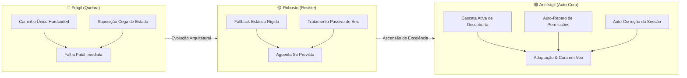

# 🛡️ Antifragile Engineering — Sistemas Resilientes e Auto-Cura

> _"Some things benefit from shocks; they thrive and grow when exposed to volatility, randomness, disorder, and stressors and love adventure, risk, and uncertainty. [...] Let us call what is non-fragile and gains from disorder 'antifragile'."_<br>
> — Nassim Nicholas Taleb, _Antifragile: Things That Gain from Disorder_ (2012)

Esta skill estabelece os princípios arquiteturais, padrões de implementação e contratos defensivos para a concepção de softwares, ferramentas de terminal, scripts de infraestrutura, loaders multi-shell e configurações que não apenas resistem a mudanças e desordem, mas **auto-descobrem caminhos, corrigem seu próprio estado em tempo de voo e adaptam-se continuamente ao ecossistema hospedeiro**.

---

## 🏛️ O Espectro da Resiliência Sistêmica

Em engenharia de sistemas e ambientes operacionais heterogêneos, a resposta a anomalias (como migração de diretórios, ausência de variáveis de ambiente ou permissões POSIX corrompidas) categoriza o design em três estados:



| Dimensão                   | 🔴 Frágil                                            | 🟡 Robusto                                  | 🟢 Antifrágil (Canônico)                                                    |
| :------------------------- | :--------------------------------------------------- | :------------------------------------------ | :-------------------------------------------------------------------------- |
| **Localização de Arquivo** | Caminho estático fixo (`~/.app/data`)                | Se não estiver em A, tenta B                | Cascata dinâmica de inspeção (Env $\rightarrow$ Contexto $\rightarrow$ XDG) |
| **Permissões POSIX**       | Rejeitado pelo comando (`ssh: permissions too open`) | Exibe mensagem de erro orientando o usuário | **Auto-cura silenciosa** (`chmod 0600`) antes de disparar o comando         |
| **Variáveis de Sessão**    | Variável nula quebra o script (`nil pointer`)        | Usa default estático                        | Descobre o recurso real e **atualiza a variável na sessão ativa**           |
| **Execução de Comandos**   | Alias estático (`alias cmd='run -i key'`)            | Função básica sem repasse de flags          | **Função com argument forwarding completo** (`"$@"`) e delegação            |
| **Falha de Recurso**       | Aborta com stacktrace ou `No such file`              | Retorna código de erro limpo                | Tenta vias alternativas (ex: `ssh-agent`) antes de desistir graciosamente   |

---

## 📐 Os 5 Pilares da Engenharia Antifrágil

### 1. Cascata Ativa de Descoberta (_Active Discovery Cascade_)

Nenhum script, loader ou utilitário deve presumir que um arquivo vive em uma única localização predeterminada. A descoberta inspeciona ativamente múltiplos níveis hierárquicos em ordem de especificidade:

1. **Variável Explícita de Ambiente:** Se definida pelo usuário **E** o arquivo referenciado existir fisicamente no disco (`[ -f "${VAR}" ]`).
2. **Diretório Ativo do Componente:** Diretório raiz injetado pelo orquestrador (`${VAULT_DIR}/...`, `${SHELL_REPO_DIR}/...`).
3. **Padrão Canônico XDG Data:** `${XDG_DATA_HOME:-${HOME}/.local/share}/<app>/...` (preferencial para dados do usuário e runtimes).
4. **Padrão Canônico XDG Config:** `${XDG_CONFIG_HOME:-${HOME}/.config}/<app>/...` (preferencial para dotfiles e configurações).
5. **Fallback Tradicional de Usuário:** `${HOME}/.<app>/...` (compatibilidade com UNIX clássico e Windows MSYS2).
6. **Espaço Global do Sistema (FHS):** `/usr/local/share/<app>/...` ou `/etc/<app>/...`.

### 2. Auto-Cura em Tempo de Voo (_In-Flight Permission Self-Healing_)

Sistemas operacionais e ferramentas de segurança (como OpenSSH, GnuPG e certificados SSL) recusam arquivos sensíveis cujas permissões sejam permissivas demais.

Em vez de quebrar a execução com advertências crípticas, o utilitário antifrágil **cura o metadado na hora da chamada**:

```sh
if [ -n "${_found_key}" ] && [ -f "${_found_key}" ]; then
	chmod 0600 "${_found_key}" 2> "/dev/null" || true
fi
```

### 3. Auto-Correção do Ambiente da Sessão (_Session Environment Self-Correction_)

Quando uma função descobre a localização real de um recurso após uma falha de caminho estático ou variável desatualizada, ela não guarda essa descoberta para si. Ela **repara o ambiente da sessão corrente**:

```sh
export PERSONAL_SERVER_KEY="${_resolved_key}"
```

Isso garante que subprocessos, ferramentas subordinadas (editores, Git, IDEs) e chamadas subsequentes aproveitem o estado curado sem novo overhead de busca.

### 4. Zero Falha Cega & Encaminhamento Total (_Zero Blind Failure & Argument Forwarding_)

- Se a chave privada física não for encontrada no disco, o utilitário não injeta `-i ""` ou caminhos inexistentes que garantem falha no `ssh`. Ele verifica se há chaves carregadas no agente (`ssh-add -l`) ou invoca o comando sem a flag restritiva, permitindo que chaves de hardware (FIDO2/YubiKey) ou autenticações alternativas funcionem.
- Sempre preserve argumentos variáveis (`"$@"` no Shell, `$args` no PowerShell, `...rest` no NuShell), transformando aliases estáticos em comandos utilitários flexíveis.

### 5. Invariante de Clonagem "Out-of-the-Box" (_Zero-Tweaks Git Invariant_)

Sistemas antifrágeis não exigem que o operador execute intervenções manuais de pós-instalação após um `git clone`:

- **Permissões no Git Index:** Modos octais canônicos (`0755` para scripts/hooks executáveis, `0644` para configurações e documentação, `0700`/`0600` para segredos) são mantidos estritamente pelo controle de versão.
- **Auto-Cura Pós-Clone:** Scripts de entrada e inicializadores detectam se estão rodando sob sistemas de arquivos que não preservam bits POSIX (ex: NTFS, FAT32, montagens WSL) e aplicam `chmod 0755` defensivamente aos seus subordinados antes da execução.
- **Zero Diretórios Órfãos:** Scripts garantem a existência de seus diretórios de trabalho (`mkdir -p`) no momento do uso, prevenindo falhas de `No such file or directory`.

### 6. Resolução Antifrágil de Privilégios (_Antifragile Elevation Pattern_)

Em scripts de infraestrutura executados sob a diretiva de integridade estrita `set -eu`, comandos ternários de substituição de comando (como `ELEVATE="$( [ "$(id -u)" -ne 0 ] && ... )"`) constituem uma armadilha de fragilidade:

- Quando o script é executado como superusuário (`root` ou via `sudo`), a condição `[ "$(id -u)" -ne 0 ]` é falsa e a substituição sai com status `1`.
- Sob `set -e`, o interpretador POSIX encerra imediatamente o script inteiro.

O padrão canônico antifrágil exige a estrutura condicional explícita e imune a `set -e`:

```sh
ELEVATE=""
if [ "$(id -u)" -ne 0 ]; then
	if command -v doas > "/dev/null" 2>&1; then
		ELEVATE="doas"
	elif command -v sudo > "/dev/null" 2>&1; then
		ELEVATE="sudo"
	fi
fi
```

### 7. Invariante de Shift Seguro de Argumentos (_Safe Shift Invariant_)

No padrão POSIX, o comando `shift` é um utilitário especial embutido (_special built-in utility_). Se `shift N` for executado quando `$#` for menor que `N`, as especificações POSIX determinam que o shell encerre **incondicionalmente** sob `set -e`, ignorando até mesmo `|| true`.

O padrão antifrágil determina que todo deslocamento de argumentos deve ser precedido de validação:

```sh
# Deslocamento simples:
[ "$#" -ge 1 ] && shift

# Deslocamento múltiplo com argumentos remanescentes:
if [ "$#" -ge 2 ]; then
	shift 2
	comments="$*"
else
	comments=""
fi
```

### 8. Auto-Cura Reentrante de Perfis Multi-Shell (_Cross-Shell Profile Self-Healing_)

Sistemas que operam com múltiplos shells nativos (PowerShell, NuShell, CMD) não devem obrigar o usuário a copiar arquivos de configuração manualmente (`cp`, `Copy-Item`).

O comando de atualização de qualquer shell (`upsh`, `resh`) detecta a presença dos demais e atualiza atomicamente seus arquivos físicos em disco (`Documents\PowerShell\profile.ps1`, `%APPDATA%\nushell\config.nu`, `%LOCALAPPDATA%\clink\profile.lua`):

```powershell
if ($env:APPDATA) {
	$appNu = Join-Path $env:APPDATA "nushell"
	$nuSrc = Join-Path $target "target\windows\nushell"
	if ((Test-Path $appNu) -and (Test-Path $nuSrc)) {
		foreach ($f in @("config.nu", "env.nu")) {
			Copy-Item (Join-Path $nuSrc $f) (Join-Path $appNu $f) -Force
		}
	}
}
```

### 9. Imunidade a Recursão de Aliases Case-Insensitive (_Case-Insensitive Alias Recursion Guard_)

Em runtimes onde resolução de comandos e aliases é insensível a maiúsculas/minúsculas (como PowerShell), criar um alias com o mesmo nome da função (ex: `New-Alias "foo-bar" "Foo-Bar"`) cria um loop circular auto-referencial. O interpretador suprime a função e tenta buscar `foo-bar.exe` no PATH.

**Regra Antifrágil:** Funções nunca devem ter aliases com o mesmo nome. Aliases de atalho devem usar exclusivamente `Set-Alias -Force -Option AllScope` para garantir reentrância idempotente.

### 10. Sincronização Dual de PATH em Runtimes Case-Sensitive sob Windows

O Windows NT armazena a variável do sistema como `Path`, enquanto runtimes como NuShell tratam variáveis em `$env` de forma case-sensitive. Se o script apenas manipular `$env.PATH` (all caps), a variável do sistema `$env.Path` permanece desatualizada e subprocessos Win32 não encontram ferramentas recém-adicionadas.

**Regra Antifrágil:** Definir `$env.ENV_CONVERSIONS` para ambas as variantes e atribuir o caminho normalizado a ambas:

```nushell
$env.Path = $_cleaned_path
$env.PATH = $_cleaned_path
```

### 11. Injeção Dinâmica Defensiva de Credenciais Git (_Dynamic Credential Helper Injection_)

Em runtimes onde a execução de subprocessos pode isolar ou não herdar perfeitamente o ambiente do helper do Git, repositórios privados recebem a injeção explícita do helper (`gh auth git-credential`) via flag `-c`:

```nushell
let gh_bin = (get-gh-cmd)
if ($gh_bin | is-not-empty) {
	let helper_arg = $"credential.https://github.com.helper=!\"($gh_bin)\" auth git-credential"
	^$git_bin -C $target -c $helper_arg pull --ff-only
}
```

---

## 🛠️ Padrões Canônicos por Interpretador

### 1. Padrão Universal POSIX `/bin/sh`

```sh
_resolve_vault_key() {
	_explicit="${1:-}"
	_filename="${2:-}"

	if [ -n "${_explicit}" ] && [ -f "${_explicit}" ]; then
		chmod 0600 "${_explicit}" 2> "/dev/null" || true
		echo "${_explicit}"
		return 0
	fi

	for _cand in \
		"${VAULT_DIR:-}/keys/${_filename}" \
		"${XDG_DATA_HOME:-${HOME}/.local/share}/vault/keys/${_filename}" \
		"${XDG_CONFIG_HOME:-${HOME}/.config}/vault/keys/${_filename}" \
		"${HOME}/.vault/keys/${_filename}" \
		"/usr/local/share/vault/keys/${_filename}"; do
		if [ -n "${_cand}" ] && [ -f "${_cand}" ]; then
			chmod 0600 "${_cand}" 2> "/dev/null" || true
			echo "${_cand}"
			return 0
		fi
	done

	return 1
}

connect_server() {
	_ip="${SERVER_IP:-127.0.0.1}"
	_user="${SERVER_USER:-root}"
	_key="$(_resolve_vault_key "${SERVER_KEY:-}" "id_ed25519")"

	if [ -n "${_key}" ]; then
		export SERVER_KEY="${_key}"
		ssh -i "${_key}" "${_user}@${_ip}" "$@"
	else
		ssh "${_user}@${_ip}" "$@"
	fi
}
```

### 2. Padrão NuShell

```nu
def --wrapped server-connect [...rest] {
	let ip = ($env.SERVER_IP? | default "127.0.0.1")
	let user = ($env.SERVER_USER? | default "root")
	let key = ($env.SERVER_KEY? | default "")
	if ($key | is-not-empty) and ($key | path exists) {
		ssh -i $key $"($user)@($ip)" ...$rest
	} else {
		ssh $"($user)@($ip)" ...$rest
	}
}
```

### 3. Padrão PowerShell

```powershell
function Resolve-Asset([string]$explicitPath, [string]$relativeSubpath) {
	if ($explicitPath -and (Test-Path $explicitPath)) { return $explicitPath }
	$homeDir = if ($env:USERPROFILE) { $env:USERPROFILE } elseif ($env:HOME) { $env:HOME } else { "~" }
	$candidates = @(
		if ($env:VAULT_DIR) { Join-Path $env:VAULT_DIR $relativeSubpath },
		(Join-Path $homeDir ".local\share\vault\$relativeSubpath"),
		(Join-Path $homeDir ".config\vault\$relativeSubpath"),
		(Join-Path $homeDir ".vault\$relativeSubpath")
	) | Where-Object { $_ -and (Test-Path $_) }
	if ($candidates) { return $candidates[0] }
	return $null
}
```

---

## ⚠️ Anti-Patterns da Fragilidade

### ❌ Anti-Pattern 1: Caminho Falso-Soberano Hardcoded

```sh
# FRÁGIL: Quebra se o cofre estiver em ~/.local/share/vault ou se o usuário mudar de máquina
KEY="${HOME}/.vault/keys/server.key"
ssh -i "${KEY}" user@host
```

**Consequência:** `Warning: Identity file ... not accessible. Permission denied (publickey).`

### ❌ Anti-Pattern 2: Concatenação Cega de Nil em Runtimes Modernos

```lua
-- FRÁGIL: Se a variável de ambiente não estiver exportada, lança exceção fatal
["my-server"] = "ssh -i " .. os.getenv("SERVER_KEY") .. " user@host"
```

**Consequência:** `attempt to concatenate a nil value (local 'SERVER_KEY')` que impede o loader inteiro de carregar.

### ❌ Anti-Pattern 3: Parse-Time Static Sourcing em NuShell

```nu
# FRÁGIL: NuShell valida existência no tempo de parse. Se o arquivo não existir, o terminal fecha!
source ~/.vault/vault.nu
```

**Consequência:** `nu::shell::file_not_found` impede a inicialização de qualquer sessão interativa.

### ❌ Anti-Pattern 4: Suposição Rígida de Diretório em Pontes Host/Guest (NFS/Virtualização)

```sh
# FRÁGIL: Se o comando for executado fora do escopo de montagem (/home/gabrielf), quebra no guest
ssh guest "cd \"$PWD\" && agy $*"
```

**Consequência:** `cd: /usr/ports: No such file or directory` aborta a execução do agente.

**Correção Antifrágil (Canônica):**

```sh
_target_dir="/home/gabrielf"
case "${PWD}" in
    /home/gabrielf|/home/gabrielf/*) _target_dir="${PWD}" ;;
esac
ssh guest "cd \"${_target_dir}\" 2> /dev/null || cd /home/gabrielf; env HOME=/home/gabrielf agy $*"
```

---

## 🔗 Obras de Referência & Fontes Canônicas

- **Taleb, Nassim Nicholas.** _Antifragile: Things That Gain from Disorder_. Random House, 2012.
- **Raymond, Eric S.** _The Art of UNIX Programming_. Addison-Wesley, 2003.
- **The Open Group Base Specifications Issue 8 (POSIX.1-2024):** <https://pubs.opengroup.org/onlinepubs/9799919799/>
- **OpenSSH Client Configuration Manual (`ssh_config(5)`):** <https://man.openbsd.org/ssh_config.5>
- **XDG Base Directory Specification:** <https://specifications.freedesktop.org/basedir-spec/basedir-spec-latest.html>
