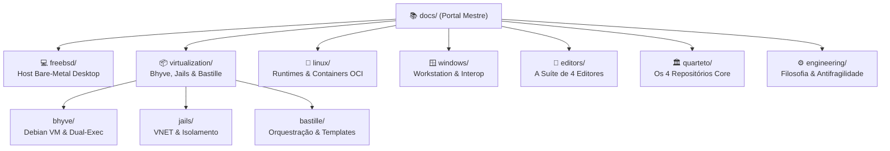

# 🏛️ Universal Environment: Biblioteca de Documentação Canônica

> Enciclopédia técnica de arquitetura, governança e runbooks operacionais do ecossistema federado multiplataforma de Gabriel Frigo.

---

## 🧭 Visão Geral & Filosofia Editorial

O **Universal Environment** é um hub de orquestração soberano que governa estações de trabalho heterogêneas (**FreeBSD**, **Linux** e **Windows**) através do **Quarteto de Produtividade** e de uma **Suíte de 4 Editores Autônomos**.

Para suportar essa arquitetura sem fragmentação de conhecimento ou atrito operacional, esta pasta reúne a **documentação canônica autoritativa** de todo o ecossistema:

- **Arquitetura Hub & Spoke:** Cada domínio tecnológico vive em seu próprio diretório autônomo com um portal conceitual (`README.md`) e guias especializados numerados (`01-...`, `02-...`).
- **Clean Code & POSIX:** Procedimentos rigorosamente reproduzíveis, idempotentes, imunes a falhas sob `set -eu` e alinhados aos 22 Princípios UNIX.
- **Hermetismo Técnico:** Zero narrativa supérflua; foco absoluto em arquitetura, diagramas Mermaid, parâmetros de sistema e runbooks de engenharia.

---

## 🗺️ Mapa Completo de Navegação (Sitemap)

### 💻 1. [Host FreeBSD Desktop](freebsd/README.md)

Documentação do sistema operacional base da estação de trabalho e hipervisor bare-metal:

- **[01-kernel-boot-e-loader.md](freebsd/01-kernel-boot-e-loader.md):** Inicialização modular, `/boot/loader.conf` e tuning em `/etc/sysctl.conf`.
- **[02-zfs-storage-e-arc.md](freebsd/02-zfs-storage-e-arc.md):** Storage ZFS, pools, datasets dedicados, governança de ARC e snapshots atômicos.
- **[03-redes-e-firewall-pf.md](freebsd/03-redes-e-firewall-pf.md):** Interfaces físicas (`wlan0`, `em0`), pontes virtuais, NAT e regras estritas do Packet Filter.
- **[04-graficos-drm-e-wayland.md](freebsd/04-graficos-drm-e-wayland.md):** Intel Alder Lake-P (12ª Geração), `drm-kmod`, mitigação de PSR/FBC e KDE Plasma 6 Wayland.
- **[05-consoles-e-display-managers.md](freebsd/05-consoles-e-display-managers.md):** Formatação tabular simétrica do `/etc/ttys`, Ly TUI Display Manager e fontes Spleen.
- **[06-dispositivos-e-audio.md](freebsd/06-dispositivos-e-audio.md):** Áudio USB (`hw.snd`), roteamento RTP, daemon de vídeo USB `webcamd` e permissões devfs.

### 📦 2. [Virtualização & Camadas de Isolamento](virtualization/README.md)

A tríade de isolamento nativa do FreeBSD:

- **[virtualization/bhyve/](virtualization/bhyve/README.md):** Hipervisor Bhyve com runtime Debian 13 headless, ponte NFSv3 bidirecional e despacho duplo do `agy`.
- **[virtualization/jails/](virtualization/jails/README.md):** Jails FreeBSD nativas, pilha de rede virtualizada VNET e regras de segurança devfs.
- **[virtualization/bastille/](virtualization/bastille/README.md):** Orquestração com BastilleBSD, automação de templates e gestão de containers FreeBSD.

### 🐧 3. [Linux Runtimes & Containers](linux/README.md)

Ambientes GNU/Linux nativos e virtuais:

- **01-paridade-posix-e-gnu.md:** Paridade estrita de UID/GID 1001, caminhos canônicos XDG e mapeamentos NFSv3.
- **02-containers-e-podman.md:** Containers OCI rootless, soquetes Podman e compatibilidade Docker.

### 🪟 4. [Suporte & Interoperabilidade Windows](windows/README.md)

Integração com estações Windows:

- **01-powershell-e-nushell.md:** Perfis de shell modernos (`profile.ps1`, `config.nu`) e biblioteca `_ui_*`.
- **02-seguranca-e-ssh-pageant.md:** Integração de chaves SSH com PuTTY/Pageant a partir do Vault.

### 📝 5. [A Suíte de 4 Editores Autônomos](editors/README.md)

Editores modais e ambientes de desenvolvimento soberanos:

- **01-emacs.md:** GNU Emacs com carregamento assíncrono Elpaca, Org-mode e integração IA.
- **02-helix.md:** Helix Editor modal em Rust com Tree-sitter e LSP nativo.
- **03-neovim.md:** NeoVim em Lua com arquitetura FHS, Lazy.nvim, Mason e Kanagawa.
- **04-vim.md:** Vim clássico em Vimscript, Vim-Plug, tema CodeDark e suporte estrito a TTYs puros.

### 🏛️ 6. [O Quarteto de Infraestrutura](quarteto/README.md)

Arquitetura detalhada dos 4 repositórios complementares:

- **01-setup.md:** Provisionamento de SO, cookbooks modulares e invariante zero-clone.
- **02-shell.md:** Motor interativo de terminal, prompts < 64ms e UI semântica.
- **03-vault.md:** Cofre criptográfico, isolamento de chaves SSH e loaders multi-shell.
- **04-profile.md:** Dotfiles declarativos, links simbólicos seguros e skills de IA.

### ⚙️ 7. [Metodologia & Engenharia Antifrágil](engineering/README.md)

Fundamentos de engenharia de software de Gabriel Frigo:

- **01-os-22-principios-unix.md:** Comentários aprofundados sobre os 22 princípios canônicos.
- **02-antifragilidade-e-self-healing.md:** Resolução em cascata, elevação imune a `set -e` e shift seguro.
- **03-clean-break-refactoring.md:** Política zero-cruft e expurgo limpo sem legado transitório.
- **04-bancada-vs-producao.md:** Ciclo de propagação: bancada $\rightarrow$ Git Push $\rightarrow$ Git Pull em produção.

---

## ⚡ Referências Rápidas do Hub

- **Documentação Canônica de Arquitetura:** [`ENVIRONMENT.md`](../ENVIRONMENT.md)
- **Os 22 Princípios UNIX & Clean Code:** [`PRINCIPLES.md`](../PRINCIPLES.md)
- **Matriz de Status & Roadmap:** [`TODO.md`](../TODO.md)
