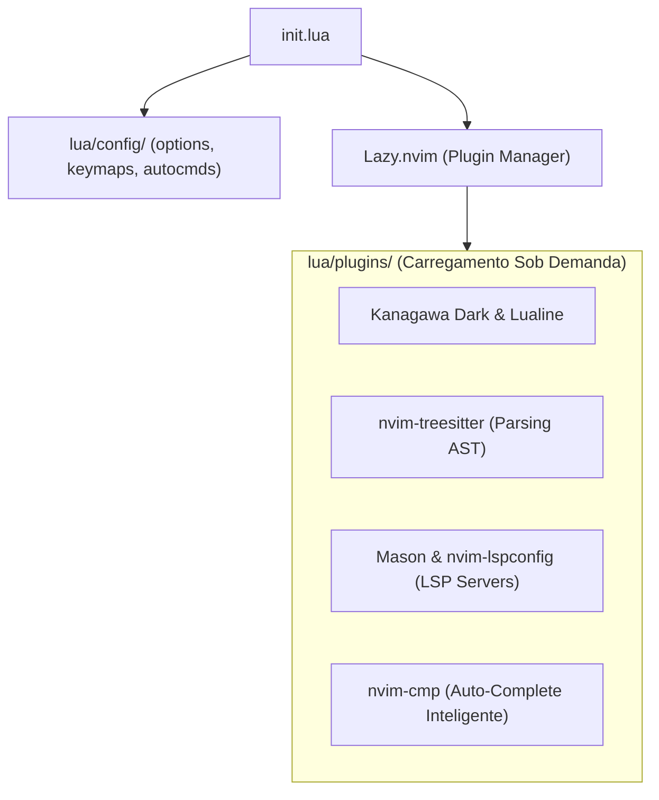

# ⚡ NeoVim: Arquitetura Modular em Lua, Lazy & Mason

> Documentação canônica do NeoVim no Universal Environment: arquitetura modular FHS, carregamento sob demanda via Lazy.nvim, governança de LSP com Mason e tema Kanagawa Dark.

---

## 🧭 Visão Geral & Filosofia do NeoVim

O **NeoVim** atua como a ferramenta de desenvolvimento diária de maior flexibilidade do ecossistema. Abandonando o legado de arquivos monolíticos `.vimrc`, o NeoVim foi reconstruído com base na linguagem **LuaJIT**, permitindo tempos de execução de código que rivalizam com C e arquiteturas de plugins altamente desacopladas.

No Universal Environment, o repositório `Editor/NeoVim` implementa:

1. **Estrutura Modular FHS (Filesystem Hierarchy Standard):** Separação estrita entre `options`, `keymaps`, `autocmds` e receitas atômicas de plugins sob `lua/plugins/`.
2. **Lazy-Loading Extremo:** Inicialização em menos de 25 milissegundos graças ao carregamento diferido condicional (apenas carregando plugins quando buffers específicos são abertos).
3. **Gestão Desacoplada de Ferramentas (Mason):** Binários de LSP, debuggers (DAP) e linters são instalados de forma isolada em `~/.local/share/nvim/mason`, sem poluir o PATH do sistema operacional.



---

## 🗄️ Arquitetura de Diretórios Canônica

```text
~/.config/nvim/
├── init.lua
└── lua/
    ├── config/
    │   ├── autocmds.lua
    │   ├── keymaps.lua
    │   ├── lazy.lua
    │   └── options.lua
    └── plugins/
        ├── colorscheme.lua   # Kanagawa Dark
        ├── editor.lua        # Telescope, Which-key
        ├── lsp.lua           # Mason, LSPConfig
        └── treesitter.lua    # Destaque sintático
```

---

## 📦 Governança de Plugins via Lazy.nvim

O arquivo `lua/config/lazy.lua` inicializa o gerenciador com clonagem automática e tolerância a falhas:

```lua
-- Bootstrapping defensivo do Lazy.nvim
local lazypath = vim.fn.stdpath("data") .. "/lazy/lazy.nvim"
if not vim.loop.fs_stat(lazypath) then
  vim.fn.system({
    "git",
    "clone",
    "--filter=blob:none",
    "https://github.com/folke/lazy.nvim.git",
    "--branch=stable",
    lazypath,
  })
end
vim.opt.rtp:prepend(lazypath)

-- Carregamento declarativo da pasta lua/plugins/
require("lazy").setup({
  spec = { { import = "plugins" } },
  defaults = { lazy = true },
  performance = {
    rtp = {
      disabled_plugins = { "gzip", "tarPlugin", "tohtml", "tutor", "zipPlugin" },
    },
  },
})
```

---

## 🧪 Testes Automatizados Headless

O repositório `Editor/NeoVim` valida cada modificação através de testes executados sem display gráfico:

```sh
# Executar suíte de testes de sanidade
make -C Editor/NeoVim test
```

Esse comando roda o NeoVim em modo `--headless`, verifica erros de sintaxe em arquivos Lua e valida se todos os módulos carregam com sucesso.
