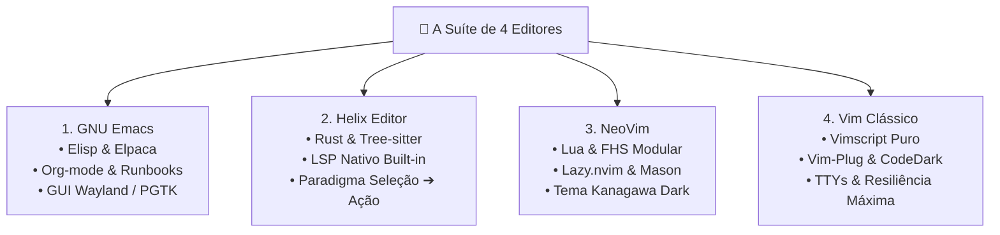

# 📝 A Suíte de 4 Editores Autônomos

> Documentação canônica sobre a suíte de editores de texto soberanos do Universal Environment: Emacs, Helix, NeoVim e Vim.

---

## 🧭 Visão Geral & Filosofia da Suíte de Editores

No Universal Environment, nenhum desenvolvedor está preso a um único editor monolítico. Em vez de impor uma escolha forçada, o ecossistema provê uma **Suíte de 4 Editores Autônomos**, projetada sob a máxima: **o editor certo para a tarefa certa no ambiente certo**.

Cada editor opera como um **repositório Git independente**, com sua própria suíte de testes de inicialização em modo batch/headless (`make test`), contratos de carregamento assíncrono e zero dependência mútua:

1. **GNU Emacs (O Centro de Computação Pessoal):** Ambiente extensível em Elisp, gerenciador assíncrono Elpaca, Org-mode e integração gráfica avançada.
2. **Helix Editor (O Editor Pós-Moderno em Rust):** Editor modal zero-configuração com LSP e Tree-sitter nativos embutidos, sem dependência de gerenciadores de plugins ou NodeJS.
3. **NeoVim (O IDE Modal Modular em Lua):** Editor modal moderno com arquitetura FHS, Lazy.nvim para inicialização em microssegundos e ecossistema Mason para LSPs.
4. **Vim Clássico (O Baluarte UNIX Soberano):** Editor clássico em Vimscript puro com Vim-Plug e tema CodeDark, garantindo compatibilidade absoluta mesmo em consoles virtuais mínimos (`ttyv0`).



---

## 📊 Matriz Comparativa da Suíte

| Dimensão                | 🦣 GNU Emacs                    | 🧬 Helix                           | ⚡ NeoVim                            | 🏛️ Vim Clássico                  |
| :---------------------- | :------------------------------ | :--------------------------------- | :----------------------------------- | :------------------------------- |
| **Linguagem Base**      | C / Emacs Lisp                  | Rust                               | C / LuaJIT                           | C / Vimscript                    |
| **Paradigma Modal**     | Keychords (`C-`, `M-`) ou Evil  | Modal (Seleção $\rightarrow$ Ação) | Modal (Ação $\rightarrow$ Movimento) | Modal Clássico                   |
| **Gestor de Extensões** | Elpaca (Assíncrono)             | Zero Plugins (Built-in)            | Lazy.nvim                            | Vim-Plug                         |
| **Suporte a LSP**       | Eglot / LSP-mode                | Nativo em Rust                     | Mason / nvim-lspconfig               | vim-lsp / ALE                    |
| **Tempo Médio de Boot** | ~0.8s (Elpaca Lazy)             | < 10ms                             | < 25ms                               | < 15ms                           |
| **Melhor Caso de Uso**  | Notas, Org-mode, Lisp, Projetos | Edição rápida, Rust, Go, CLI       | Desenvolvimento diário Full-Stack    | Edição remota, TTYs, recuperação |

---

## 📚 Índice da Seção

| Arquivo                            | Título                            | Foco Operacional                                                                         |
| :--------------------------------- | :-------------------------------- | :--------------------------------------------------------------------------------------- |
| **[`01-emacs.md`](01-emacs.md)**   | GNU Emacs (Elisp & Elpaca)        | Carregamento assíncrono Elpaca, `early-init.el`, Org-mode e testes headless.             |
| **[`02-helix.md`](02-helix.md)**   | Helix Editor (Rust & Tree-sitter) | Configuração TOML, LSP nativo, tema Kanagawa e ergonomia seleção $\rightarrow$ ação.     |
| **[`03-neovim.md`](03-neovim.md)** | NeoVim (Lua, Lazy & Mason)        | Arquitetura modular FHS, Lazy.nvim, Mason LSP, treesitter e kanagawa.nvim.               |
| **[`04-vim.md`](04-vim.md)**       | Vim Clássico (UNIX Soberano)      | Vimscript limpo, `.vimrc` autocontido, compatibilidade TTY e zero dependências externas. |

---

## ⚡ Comandos de Auditoria da Suíte

```sh
# Testar a suíte completa a partir do repositório Environment
make -C Editor/Helix test
make -C Editor/NeoVim test
make -C Editor/Vim test
make -C Editor/Emacs test
```
