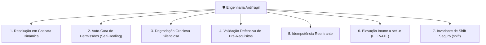

# 🛡️ Sistemas Antifrágeis & Auto-Cura em Tempo de Voo

> A fundamentação prática da Engenharia Antifrágil no Universal Environment: os 7 Pilares de robustez adaptativa, resolução em cascata e imunidade a falhas sob `set -eu`.

---

## 🧭 O Conceito de Antifragilidade Aplicado à Infraestrutura

Conforme formulado por Nassim Nicholas Taleb, sistemas dividem-se em três categorias sob estresse e perturbação:

- **O Sistema Frágil:** Quebra catastroficamente ao sofrer o menor choque imprevisto. Exemplos: scripts que abortam silenciosamente se uma variável não existir, ou que falham ao serem executados como superusuário devido a ternários mal concebidos.
- **O Sistema Robusto:** Resiste a choques até certo limite mecânico, mas não evolui nem aprende com o atrito.
- **O Sistema Antifrágil:** Não apenas sobrevive a perturbações, mas **adapta-se dinamicamente e auto-cura suas próprias falhas em tempo de execução**, tornando-se mais resiliente a cada nova execução.

No Universal Environment, a antifragilidade é materializada em **7 Pilares Canônicos de Engenharia**.

---

## 🏛️ Os 7 Pilares da Engenharia Antifrágil



---

### Pilar 1: Resolução Dinâmica em Cascata

Nunca confie em um caminho absoluto estático. O ecossistema busca artefatos e ferramentas através de cascatas ordenadas de precedência:

1. Variável de ambiente explícita definida pelo usuário (ex: `$XDG_CONFIG_HOME`).
2. Caminho canônico no `$HOME` do usuário.
3. Caminho padrão do sistema operacional em `/usr/local` ou `/usr`.
4. Fallback semântico seguro com valor padrão pré-definido.

### Pilar 2: Auto-Cura de Permissões em Tempo de Voo

Se um repositório for clonado em um sistema de arquivos que não preserva os bits de execução POSIX (como NTFS montado sem permissões POSIX no Windows ou volumes compartilhados), os entrypoints auto-detectam e auto-corrigem suas permissões canônicas em tempo de voo (`_self_heal_perms`), eliminando a necessidade de intervenções manuais (`chmod +x`).

### Pilar 3: Degradação Graciosa Silenciosa

Recursos acessórios (como integração com fzf, zoxide ou temas gráficos avançados) enriquecem a experiência se presentes, mas **sua ausência nunca impede o terminal de abrir ou scripts de operarem**.

### Pilar 4: Validação Defensiva de Pré-Requisitos

Antes de invocar comandos externos, os scripts verificam a presença dos binários via `command -v binario > "/dev/null" 2>&1`, emitindo instruções amigáveis via `_ui_err` em vez de mensagens incompreensíveis do interpretador.

### Pilar 5: Idempotência Reentrante

Toda operação de escrita verifica o estado atual antes de aplicar alterações:

- Se uma linha já existe no arquivo de configuração, ela não é duplicada.
- Se um link simbólico já aponta para o destino correto, ele não é recriado.

### Pilar 6: Elevação Imune a `set -e` (`ELEVATE`)

Subshells emulando ternários (`ELEVATE="$( [ cond ] && ... )"`) encerram imediatamente o interpretador sob `set -e` quando a condição é falsa. O ecossistema impõe a substituição definitiva pelo bloco explícito:

```sh
# Padrão Antifrágil Canônico:
ELEVATE=""
if [ "$(id -u)" -ne 0 ]; then
    if command -v sudo > "/dev/null" 2>&1; then
        ELEVATE="sudo"
    elif command -v doas > "/dev/null" 2>&1; then
        ELEVATE="doas"
    else
        echo "❌ Privilégios de superusuário necessários." >&2
        exit 1
    fi
fi
```

### Pilar 7: Invariante de Shift Seguro (`shift`)

Sob `set -e` em POSIX `/bin/sh`, executar `shift N` quando o número de argumentos disponíveis for menor que $N$ resulta em encerramento fatal imediato da execução, mesmo se acompanhado de `|| true`. Todo comando `shift` deve ser protegido pela validação de contagem:

```sh
# Padrão Antifrágil Canônico:
[ "$#" -ge 1 ] && shift
[ "$#" -ge 2 ] && shift 2
```
