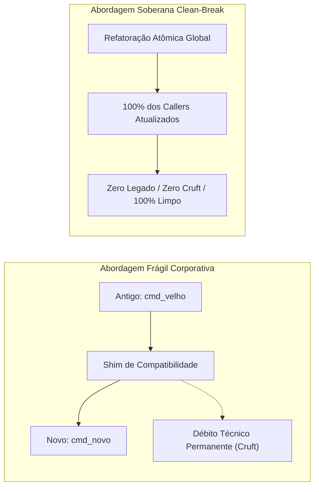

# ✂️ Refatoração Sem Legado: A Invariante Clean-Break (Zero-Cruft)

> A política soberana de refatoração no Universal Environment: por que ecossistemas monousuário rejeitam shims de compatibilidade, wrappers obsoletos e aliases de transição.

---

## 🧭 O Problema da Retrocompatibilidade Cega

Em bibliotecas corporativas públicas ou linguagens de programação distribuídas para milhões de usuários (como Python, Node.js ou o kernel Linux), quebrar uma interface é um evento traumático. Por essa razão, equipes de desenvolvimento acumulam décadas de **camadas de compatibilidade regressiva**:

- Funções marcadas como `deprecated` que continuam no código por 5 anos.
- Arquivos de redirecionamento encaminhando chamadas antigas para novos destinos.
- Variáveis duplicadas para dar suporte a configurações abandonadas.

No contexto de infraestrutura de desenvolvedores individuais, no entanto, **copiar esse modelo corporativo é a principal causa de apodrecimento do código (_code rot_)**. O desenvolvedor esquece quais partes ainda são necessárias, a complexidade ciclomática explode e o sistema torna-se um monstro de camadas fósseis sobrepostas.

---

## 🏛️ A Filosofia Soberana Clean-Break

O **Universal Environment** é um ecossistema **monousuário e soberano**, governado por um único desenvolvedor e arquiteto: **Gabriel Frigo**.

Por definição:

> **Não existem clientes externos de terceiros que quebrarão se você renomear um comando.** Se uma interface precisa mudar para se tornar mais elegante, limpa ou eficiente, a alteração deve ser executada de forma **atômica, definitiva e limpa (_Clean-Break_)**.

---

## 🚫 Práticas Proibidas pelo Clean-Break

Ao refatorar, renomear ou reorganizar qualquer componente do ecossistema, o desenvolvedor ou agente de IA **está terminantemente proibido de**:

1. **Criar Aliases de Transição:**
    - ❌ `alias comando_antigo="comando_novo"` (para não esquecer o comando antigo).
    - Se o comando mudou de nome, atualize sua memória e limpe o código.
2. **Manter Wrappers ou Scripts de Redirecionamento:**
    - ❌ Criar um script `antigo.sh` contendo `exec ./novo.sh "$@"` para não quebrar scripts órfãos.
    - Encontre todos os scripts que chamavam `antigo.sh` e atualize-os de imediato.
3. **Preservar Variáveis Mortas:**
    - ❌ Manter `export ANTIGO_DIR="$NOVO_DIR"` por medo de quebrar ferramentas ocultas.
4. **Comentários de "Legado" ou "Temporário":**
    - ❌ `# TODO: remover isto daqui a 2 semanas quando acostumar com a mudança`.

---

## 📋 Checklist Canônico de Execução Clean-Break

Toda refatoração no ecossistema deve seguir o protocolo de 5 etapas:

1. **Varredura Global Prévia:** Localizar recursivamente 100% das ocorrências do identificador antigo em todos os 8 repositórios (`grep -rn "identificador_antigo" .`).
2. **Substituição Atômica:** Atualizar a definição, todas as chamadas e testes simultaneamente.
3. **Auditoria de Documentação:** Atualizar referências no `ENVIRONMENT.md`, `PRINCIPLES.md`, `TODO.md` e nos guias em `docs/`.
4. **Validação Rigorosa:** Executar `make test`, `make audit` e `make ci` a partir da raiz do Environment para certificar que nenhum teste dependia do identificador antigo.
5. **Commit Atômico e Fechado:** Commitar a remoção direta sob a convenção Conventional Commits (`refactor(componente): migrar atômico para X sem suporte a Y`).
