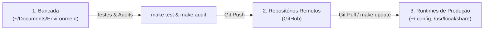

# 🏛️ Bancada de Desenvolvimento vs. Runtimes de Produção

> O ciclo soberano de trabalho no Universal Environment: separação física entre a bancada de desenvolvimento (`~/Documents/Environment`) e os clones de produção no sistema operacional.

---

## 🧭 O Problema dos Symlinks Circulares e Ambientes Sujos

Em ecossistemas de dotfiles tradicionais, usuários frequentemente criam links simbólicos diretos de suas pastas de configuração pessoais (como `~/.config/nvim` ou `~/.bashrc`) apontando diretamente para o repositório de trabalho onde estão desenvolvendo novos códigos e testando branches.

Isso introduz fragilidades severas:

- Se uma branch experimental for aberta ou se um teste quebrar arquivos, a estação de trabalho de produção quebra imediatamente no mesmo instante.
- Arquivos temporários criados pelo editor ou pelo compilador poluem o repositório Git (_working tree_ suja).
- Não há separação entre o código estável testado e o código em experimentação.

---

## 📐 A Invariante da Bancada de Desenvolvimento

No ecossistema de Gabriel Frigo, essa separação é uma regra constitucional (Regras 6 e 11 de `AGENTS.md`):

> **O repositório `Environment` (`~/Documents/Environment`) é EXCLUSIVAMENTE uma bancada de desenvolvimento e orquestração.** Nenhum artefato no diretório do Environment é consumido diretamente pelo sistema operacional hospedeiro.

### Localizações Canônicas Soberanas em Produção:

| Componente    | Localização na Bancada                   | Localização Canônica em Produção no SO             |
| :------------ | :--------------------------------------- | :------------------------------------------------- |
| **Shell**     | `~/Documents/Environment/Shell/`         | `/usr/local/share/shell` ou `~/.local/share/shell` |
| **Profile**   | `~/Documents/Environment/Profile/`       | `~/.config/profile`                                |
| **Vault**     | `~/Documents/Environment/Vault/`         | `~/.local/share/vault`                             |
| **GNU Emacs** | `~/Documents/Environment/Editor/Emacs/`  | `~/.emacs.d`                                       |
| **NeoVim**    | `~/Documents/Environment/Editor/NeoVim/` | `~/.config/nvim`                                   |
| **Helix**     | `~/Documents/Environment/Editor/Helix/`  | `~/.config/helix`                                  |
| **Vim**       | `~/Documents/Environment/Editor/Vim/`    | `~/.vim` e `~/.vimrc`                              |

---

## 🔄 O Ciclo de Propagação Canônico em 4 Etapas

A atualização de qualquer ferramenta obedece estritamente ao fluxo unidirecional:

1. **Edição & Experimentação na Bancada:** Todas as alterações em código, scripts ou documentação são implementadas e testadas sob `~/Documents/Environment/<Componente>`.
2. **Quality Gates Locais:** Antes do envio, os testes e linters são aprovados (`make test`, `make audit`, `make ci`).
3. **Commit & Push na Bancada:** Os commits são registrados no submódulo correspondente e enviados ao GitHub (`git push`).
4. **Atualização em Produção via Git Pull:** Os clones de produção recebem as atualizações exclusivamente através de `git pull` limpo (acionado pelo comando universal `make update` no Environment ou `upall`/`update-all` no terminal).

### Proibição de `cp` Avulso em Produção:

É expressamente proibido copiar arquivos avulsos (`cp arquivo ~/.config/...`) que deixem working trees sujas nos diretórios de produção. A sincronia deve sempre fluir através do controle de versão Git.
