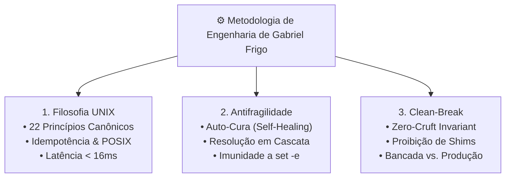

# ⚙️ Metodologia & Engenharia Antifrágil

> Documentação canônica sobre a metodologia de engenharia de software de Gabriel Frigo: os 22 Princípios UNIX, sistemas antifrágeis e a cultura de refatoração Clean-Break.

---

## 🧭 Visão Geral & Filosofia de Engenharia

O **Universal Environment** rejeita a abordagem amadora de tentativa e erro comum em repositórios de automação pessoal. Cada linha de shell script, cada regra de firewall e cada manifesto de configuração são regidos por uma **disciplina formal de engenharia de software**, concebida na interseção de três grandes tradições:

1. **A Filosofia UNIX Clássica:** Modularidade radical, texto plano como interface universal, programas que fazem uma única coisa com perfeição e composição através de pipes e contratos estritos.
2. **Clean Code & Arquitetura Soberana:** Código legível, sem ruídos narrativos desnecessários, esteticamente harmonioso e livre de acoplamento temporal.
3. **Engenharia Antifrágil (Nassim Nicholas Taleb):** Sistemas que não apenas resistem a choques e imprevistos (robustos), mas que **melhoram e se auto-curam** diante de perturbações, ausência de ferramentas ou variações de plataforma.

---

## 📚 Índice da Seção

| Arquivo                                                                            | Título                                  | Foco Metodológico                                                                                |
| :--------------------------------------------------------------------------------- | :-------------------------------------- | :----------------------------------------------------------------------------------------------- |
| **[`01-os-22-principios-unix.md`](01-os-22-principios-unix.md)**                   | Os 22 Princípios UNIX & Clean Code      | Análise comentada dos 22 princípios canônicos definidos no `PRINCIPLES.md`.                      |
| **[`02-antifragilidade-e-self-healing.md`](02-antifragilidade-e-self-healing.md)** | Sistemas Antifrágeis & Auto-Cura        | Resolução dinâmica em cascata, cura em tempo de voo, elevação `ELEVATE` e shift seguro.          |
| **[`03-clean-break-refactoring.md`](03-clean-break-refactoring.md)**               | Refatoração Sem Legado (Clean-Break)    | A política zero-cruft: por que ecossistemas soberanos não toleram aliases ou shims obsoletos.    |
| **[`04-bancada-vs-producao.md`](04-bancada-vs-producao.md)**                       | Bancada de Desenvolvimento vs. Produção | Ciclo de propagação canônico: Bancada $\rightarrow$ Git Push $\rightarrow$ Git Pull em produção. |

---

## ⚡ Referências Fundamentais

- **Declaração Constitucional de Princípios:** [`PRINCIPLES.md`](../../PRINCIPLES.md)
- **Arquitetura Geral do Ecossistema:** [`ENVIRONMENT.md`](../../ENVIRONMENT.md)
- **Runbook Cognitivo de Antifragilidade:** [`.agents/skills/antifragile-engineering/SKILL.md`](../../.agents/skills/antifragile-engineering/SKILL.md)
