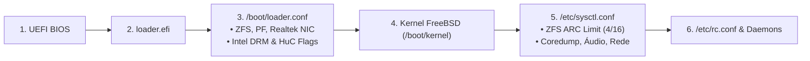

# ⚙️ Inicialização, Loader & Kernel FreeBSD

> Governança canônica do ciclo de boot do FreeBSD, carregamento modular de drivers no `/boot/loader.conf` e parametrização dinâmica de kernel via `/etc/sysctl.conf`.

---

## 🧭 Visão Geral do Ciclo de Boot

O ciclo de inicialização do FreeBSD difere fundamentalmente do ecossistema Linux tradicional. Em vez de depender de imagens `initramfs`/`initrd` complexas montadas dinamicamente, o FreeBSD opera sob uma arquitetura determinística de dois estágios principais de configuração:

1. **Estágio Pré-Kernel (`/boot/loader.conf`):** Processado pelo bootloader UEFI (`loader.efi`) antes da carga do kernel na memória física. Configura drivers residentes desde o início (ZFS, PF, controladores de disco/rede) e flags pré-carga para a GPU Intel DRM e interface Realtek (`hosts/vostro3520-freebsd.sh`).
2. **Estágio Pós-Kernel (`/etc/sysctl.conf` e `/etc/rc.conf`):** Processado pelo `init(8)` durante a inicialização multiusuário, aplicando o limite dinâmico de ARC do ZFS (`4/16` da RAM via `zfs-arc.sh`), parâmetros de segurança, rede (`net-auto-switch`), áudio e daemons.



---

## 🗄️ Configuração Canônica: `/boot/loader.conf`

O arquivo `/boot/loader.conf` do host deve permanecer limpo, modular e livre de duplicatas. Ele desativa labels GEOM redundantes, carrega os módulos fundamentais (ZFS e PF) e controladores de periféricos (`uplcom` e `ng_ubt`), além de aplicar os parâmetros de estabilidade do driver `i915kms` (`drm-66-kmod` em `< 15.2` ou `drm-kmod` em `>= 15.2`) no perfil opt-in [`hosts/vostro3520-freebsd.sh`](../../Setup/hosts/vostro3520-freebsd.sh). Já os limites dinâmicos do ZFS ARC (`vfs.zfs.arc.max` e `vfs.zfs.arc.min`) são persistidos no `/etc/sysctl.conf` por [`zfs-arc.sh`](../../Setup/freebsd/desktop/system/zfs-arc.sh).

### Conteúdo Canônico Consolidado

```text
kern.geom.label.disk_ident.enable="0"
kern.geom.label.gptid.enable="0"

zfs_load="YES"
pf_load="YES"

uplcom_load="YES"
ng_ubt_load="YES"

compat.linuxkpi.i915_enable_psr="0"
compat.linuxkpi.i915_enable_psr2_sel_fetch="0"
compat.linuxkpi.i915_enable_fbc="0"
compat.linuxkpi.i915_enable_dc="0"
compat.linuxkpi.i915_enable_guc="2"
```

### Explicação dos Parâmetros do Loader:

- **`kern.geom.label.disk_ident.enable="0"` e `gptid.enable="0"`:** Desativam a criação de labels GEOM redundantes em `/dev/`.
- **`zfs_load="YES"` e `pf_load="YES"`:** Carregam os módulos fundamentais do sistema de arquivos ZFS e do firewall Packet Filter no estágio inicial de boot.
- **`uplcom_load="YES"` e `ng_ubt_load="YES"`:** Carregam os controladores de hardware para adaptadores seriais USB e Bluetooth.
- **`compat.linuxkpi.i915_enable_psr="0"` e `i915_enable_psr2_sel_fetch="0"`:** Desativam por completo o _Panel Self Refresh_ e a busca seletiva de quadros do _PSR2_ no driver Intel Iris Xe (Alder Lake-P). Sem desativar também o `psr2_sel_fetch`, a flag permanece em `1` mesmo com `enable_psr="0"`, mantendo rotinas parciais de suspensão do painel ativas.
- **`compat.linuxkpi.i915_enable_fbc="0"`:** Desativa a compressão do framebuffer (_Framebuffer Compression_), eliminando artefatos visuais e micro-congelamentos de renderização no KDE Plasma.
- **`compat.linuxkpi.i915_enable_dc="0"`:** Desativa estados profundos de economia de energia da GPU (_Display C-states_).
- **`compat.linuxkpi.i915_enable_guc="2"`:** Habilita o microcódigo **HuC** (`2`: autenticação de workloads de mídia VA-API e decodificação acelerada) com submissão estável via CPU, prevenindo congelamentos de anel e panes de preempção do motor `rcs0`.

---

## 🎛️ Parâmetros em Tempo de Voo: `/etc/sysctl.conf`

O arquivo `/etc/sysctl.conf` aplica ajustes dinâmicos ao kernel após a inicialização: teto de cache ARC do ZFS (`zfs-arc.sh`, `4/16` da RAM física), desativação de gravação de core dumps (`freebsd/common/system/sysctl.sh`), restrição de visibilidade entre usuários (`security.bsd.see_other_uids=0`) e roteamento específico de áudio no perfil de hardware [`hosts/vostro3520-freebsd.sh`](../../Setup/hosts/vostro3520-freebsd.sh).

### Conteúdo Canônico Consolidado

```text
kern.coredump=0

vfs.zfs.arc.max=4294967296
vfs.zfs.arc.min=1073741824

hw.snd.default_unit=1
dev.pcm.2.mixer.vol_0_0.val=0
dev.pcm.2.mixer.vol_0_1.val=0

security.bsd.see_other_uids=0
```

### Explicação dos Parâmetros de Sysctl:

- **`kern.coredump=0`:** Impede que falhas de segmentação gravem arquivos de dump de gigabytes no ZFS, poupando I/O de disco e espaço de armazenamento.
- **`vfs.zfs.arc.max` e `vfs.zfs.arc.min`:** Impõem o teto de `4/16` (máximo 4 GB em host de 16 GB) e piso de 1 GB ao ARC cache em tempo de execução via `zfs-arc.sh`, evitando pressão excessiva de memória sobre Wayland e VMs.
- **`hw.snd.default_unit=1` e ajustes `dev.pcm.2`:** Aplicados pelo perfil opt-in [`hosts/vostro3520-freebsd.sh`](../../Setup/hosts/vostro3520-freebsd.sh) para selecionar a saída de áudio analógica padrão no Dell Vostro 3520 e silenciar canais não utilizados do codec HDMI (`pcm2`).
- **`security.bsd.see_other_uids=0`:** Garante a privacidade de processos em execução entre diferentes usuários do sistema.

---

## 🛠️ Procedimento de Auditoria & Sanity Check

Execute no terminal do FreeBSD para verificar se todos os parâmetros foram aceitos pelo kernel ativo.

1. **Verificar teto máximo ativo do ZFS ARC, estado do coredump e áudio primário:**

```sh
sysctl vfs.zfs.arc.max vfs.zfs.arc.min kern.coredump hw.snd.default_unit
```

2. **Auditoria completa da GPU Intel (Sysctl + Firmware GuC/HuC no `dmesg`):**

```sh
sysctl compat.linuxkpi.i915_enable_psr compat.linuxkpi.i915_enable_psr2_sel_fetch compat.linuxkpi.i915_enable_fbc compat.linuxkpi.i915_enable_dc compat.linuxkpi.i915_enable_guc && dmesg | grep -iE "drmn0|guc|huc"
```
