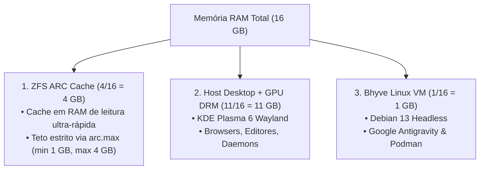

# 🗄️ Storage OpenZFS & Governança de Memória ARC

> Arquitetura de datasets, particionamento matemático de memória física em 16 partes (4/16 ARC, 11/16 Host, 1/16 VM), integridade de dados e política de snapshots no FreeBSD.

---

## 🧭 Visão Geral do OpenZFS no FreeBSD

O **OpenZFS** é o subsistema de armazenamento padrão do FreeBSD. Ele unifica os conceitos de gerenciador de volumes lógicos (LVM) e sistema de arquivos transacional em uma única camada com garantia estrita de integridade:

- **Copy-on-Write (CoW):** Blocos de dados nunca são sobrescritos no lugar (_in-place_). Uma nova escrita aloca um novo bloco e atualiza a árvore de metadados apenas após a conclusão bem-sucedida, tornando corrupções de sistema de arquivos matematicamente impossíveis mesmo sob cortes abruptos de energia.
- **Auto-Detecção de Bit-Rot:** Cada bloco de dados possui um checksum criptográfico (Blake3 ou SHA256) validado em cada leitura. Caso um setor do disco físico sofra degradação magnética silenciosa, o ZFS detecta a anomalia imediatamente.
- **Compressão Transparente:** Datasets adotam o algoritmo `zstd` (Zstandard), que reduz o espaço físico ocupado em 30% a 50% e acelera o throughput de leitura em SSDs NVMe ao ler menos bytes físicos.



---

## 📐 O Modelo Matemático de Particionamento de RAM

Em estações de trabalho de 16 GB rodando simultaneamente ZFS, ambiente gráfico moderno e máquinas virtuais, o dimensionamento cego de memória é a principal causa de travamentos e lentidão.

O ecossistema implementa o **Algoritmo de Proporção de 16 Partes** através da receita [`Setup/freebsd/desktop/system/zfs-arc.sh`](../../Setup/freebsd/desktop/system/zfs-arc.sh):

$$\text{Memória Total} = \frac{4}{16}\text{ (ARC Cache)} + \frac{11}{16}\text{ (Host Desktop + GPU)} + \frac{1}{16}\text{ (Bhyve VM)}$$

### Tabela de Dimensionamento Prático (16 GB):

| Componente             | Proporção                             | Memória Alocada (16 GB) | Mecanismo de Aplicação                                       |
| :--------------------- | :------------------------------------ | :---------------------- | :----------------------------------------------------------- |
| **ZFS ARC Cache**      | $4/16$ (25%) [piso 1 GB, teto 4 GB]   | **4.096 MB** (4 GB)     | `/boot/loader.conf` (`vfs.zfs.arc.max`) e `/etc/sysctl.conf` |
| **Host Desktop + GPU** | $11/16$ (68.75%)                      | **11.264 MB** (11 GB)   | Limite operacional do KDE Plasma e drivers DRM               |
| **Bhyve Linux VM**     | $1/16$ (6.25%) [piso 1 GB, teto 2 GB] | **1.024 MB** (1 GB)     | Configuração da VM (`debian.conf`)                           |

---

## 📂 Taxonomia de Datasets do Host

O pool primário `zroot` organiza seus dados em datasets atômicos com políticas de compressão e montagem distintas:

```text
zroot/
├── ROOT/
│   └── default
├── home/
│   └── gabrielf
├── usr/
│   ├── ports
│   └── src
├── var/
├── vm/
└── bastille/
```

- **`zroot/ROOT/default`:** Sistema operacional base FreeBSD montado em `/`.
- **`zroot/home/gabrielf`:** Diretório de usuário exportado via NFS para a VM.
- **`zroot/usr/ports` e `zroot/usr/src`:** Árvore oficial de ports (`/usr/ports`) e código-fonte do kernel (`/usr/src`).
- **`zroot/var`:** Logs e caches temporários.
- **`zroot/vm`:** Discos virtuais e imagens RAW do Bhyve.
- **`zroot/bastille`:** Bases e containers do BastilleBSD.

### Propriedades Canônicas Recomendadas:

1. **Ativar compressão ZSTD de alta performance no dataset `home`:**

```sh
sudo zfs set compression=zstd zroot/home
```

2. **Desativar gravação desnecessária de access time (`atime`) nos datasets `home` e `vm` para ganho de I/O:**

```sh
sudo zfs set atime=off zroot/home
sudo zfs set atime=off zroot/vm
```

---

## 🔄 Rotina de Snapshots e Manutenção

Snapshots no ZFS são instantâneos, atômicos e ocupam zero espaço inicial no disco.

### Comandos de Operação:

1. **Criar snapshot atômico antes de atualizações de sistema:**

```sh
sudo zfs snapshot zroot/ROOT/default@pre-upgrade-$(date +%Y%m%d)
```

2. **Listar snapshots existentes com uso de espaço:**

```sh
zfs list -t snapshot -r zroot
```

3. **Executar scrub periódico de integridade (recomenda-se mensalmente):**

```sh
sudo zpool scrub zroot
```

4. **Checar status da verificação de integridade:**

```sh
zpool status zroot
```
