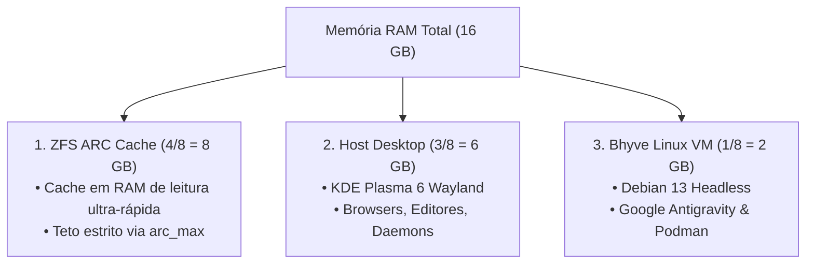

# 🗄️ Storage OpenZFS & Governança de Memória ARC

> Arquitetura de datasets, particionamento matemático de memória física (4/8 ARC, 3/8 Host, 1/8 VM), integridade de dados e política de snapshots no FreeBSD.

---

## 🧭 Visão Geral do OpenZFS no FreeBSD

O **OpenZFS** é o subsistema de armazenamento padrão do FreeBSD. Ele unifica os conceitos de gerenciador de volumes lógicos (LVM) e sistema de arquivos transacional em uma única camada com garantia estrita de integridade:

- **Copy-on-Write (CoW):** Blocos de dados nunca são sobrescritos no lugar (_in-place_). Uma nova escrita aloca um novo bloco e atualiza a árvore de metadados apenas após a conclusão bem-sucedida, tornando corrupções de sistema de arquivos matematicamente impossíveis mesmo sob cortes abruptos de energia.
- **Auto-Detecção de Bit-Rot:** Cada bloco de dados possui um checksum criptográfico (Blake3 ou SHA256) validado em cada leitura. Caso um setor do disco físico sofra degradação magnética silenciosa, o ZFS detecta a anomalia imediatamente.
- **Compressão Transparente:** Datasets adotam o algoritmo `zstd` (Zstandard), que reduz o espaço físico ocupado em 30% a 50% e acelera o throughput de leitura em SSDs NVMe ao ler menos bytes físicos.



---

## 📐 O Modelo Matemático de Particionamento de RAM

Em estações de trabalho de 16 GB rodando simultaneamente ZFS, ambiente gráfico moderno e máquinas virtuais, o dimensionamento cego de memória é a principal causa de travamentos e lentidão.

O ecossistema implementa o **Algoritmo de Proporção Octal** através da receita [`Setup/freebsd/desktop/system/zfs-arc.sh`](../../Setup/freebsd/desktop/system/zfs-arc.sh):

$$\text{Memória Total} = \frac{4}{8}\text{ (ARC Cache)} + \frac{3}{8}\text{ (Host Desktop)} + \frac{1}{8}\text{ (Bhyve VM)}$$

### Tabela de Dimensionamento Prático (16 GB):

| Componente         | Proporção     | Memória Alocada     | Mecanismo de Aplicação                  |
| :----------------- | :------------ | :------------------ | :-------------------------------------- |
| **ZFS ARC Cache**  | $4/8$ (50%)   | **8.192 MB** (8 GB) | `/boot/loader.conf` (`vfs.zfs.arc_max`) |
| **Host Desktop**   | $3/8$ (37.5%) | **6.144 MB** (6 GB) | Limite operacional do KDE Plasma        |
| **Bhyve Linux VM** | $1/8$ (12.5%) | **2.048 MB** (2 GB) | Configuração da VM (`guest.conf`)       |

---

## 📂 Taxonomia de Datasets do Host

O pool primário `zroot` organiza seus dados em datasets atômicos com políticas de compressão e montagem distintas:

```text
zroot/
├── ROOT/
│   └── default                  # Sistema operacional base FreeBSD (/)
├── home/
│   └── gabrielf                 # Diretório de usuário (NFS exportado para VM)
├── usr/
│   ├── ports                    # Árvore oficial de ports (/usr/ports)
│   └── src                      # Código-fonte do kernel (/usr/src)
├── var/                         # Logs e caches temporários
├── vm/                          # Discos virtuais e imagens RAW do Bhyve
└── bastille/                    # Bases e containers do BastilleBSD
```

### Propriedades Canônicas Recomendadas:

```sh
# Ativar compressão ZSTD de alta performance no dataset home
sudo zfs set compression=zstd zroot/home

# Desativar gravação desnecessária de access time (atime) para ganho de I/O
sudo zfs set atime=off zroot/home
sudo zfs set atime=off zroot/vm
```

---

## 🔄 Rotina de Snapshots e Manutenção

Snapshots no ZFS são instantâneos, atômicos e ocupam zero espaço inicial no disco.

### Comandos de Operação:

```sh
# 1. Criar snapshot atômico antes de atualizações de sistema
sudo zfs snapshot zroot/ROOT/default@pre-upgrade-$(date +%Y%m%d)

# 2. Listar snapshots existentes com uso de espaço
zfs list -t snapshot -r zroot

# 3. Executar scrub periódico de integridade (recomenda-se mensalmente)
sudo zpool scrub zroot

# 4. Checar status da verificação de integridade
zpool status zroot
```
