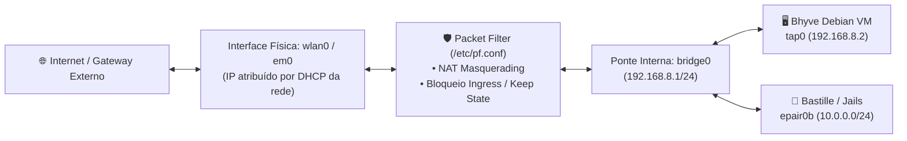

# 🛡️ Redes Físicas, NAT & Firewall Packet Filter (PF)

> Arquitetura de rede híbrida, interfaces virtuais (bridge/tap/epair), tradução de endereços (NAT) e regras estritas do Packet Filter no FreeBSD.

---

## 🧭 Visão Geral da Topologia de Rede

O FreeBSD atua simultaneamente como cliente de rede de alta velocidade (via Wi-Fi `wlan0` ou Ethernet `em0`) e como roteador interno para as camadas de isolamento (Bhyve e Jails).



---

## 📐 Topologia de Sub-redes Internas

Para permitir que a máquina virtual Bhyve e as Jails acessem a internet através da interface Wi-Fi do host sem depender de roteamento bridge externo (que a maioria dos pontos de acesso Wi-Fi bloqueia devido à restrição de MAC address único), o host implementa uma **sub-rede interna privada com NAT**:

| Interface           | Tipo    | Endereço IP             | Papel no Ecossistema                                       |
| :------------------ | :------ | :---------------------- | :--------------------------------------------------------- |
| **`wlan0` / `em0`** | Física  | Dinâmico (DHCP externo) | Saída para a internet e rede local física.                 |
| **`bridge0`**       | Virtual | `192.168.8.1/24`        | Gateway padrão para a sub-rede virtualizada.               |
| **`tap0`**          | Virtual | Conectada à `bridge0`   | Interface virtual da máquina virtual Debian Bhyve.         |
| **Debian VM**       | Guest   | `192.168.8.2/24`        | Host Linux dedicado para o Google Antigravity CLI (`agy`). |

---

## 🛡️ Configuração Canônica: `/etc/pf.conf`

O Packet Filter (PF) é habilitado no boot via `pf_load="YES"` no `/boot/loader.conf` e ativado com `pf_enable="YES"` no `/etc/rc.conf`.

### Regras Canônicas de NAT e Filtro

```text
# Macros de interfaces
ext_if = "wlan0"
vm_net = "192.168.8.0/24"

# Opções de normalização e segurança
set skip on lo0
scrub in all fragment reassemble

# Tradução de Endereço de Rede (NAT) para a VM Bhyve e Jails
nat on $ext_if from $vm_net to any -> ($ext_if)

# Política padrão: bloqueio restritivo de entrada
block in all
pass out all keep state

# Permitir tráfego irrestrito na rede virtual interna
pass on bridge0 from any to any
pass on tap0 from any to any

# Permitir conexões SSH seguras do host para a VM
pass in on bridge0 proto tcp from 192.168.8.1 to 192.168.8.2 port 22 keep state
```

---

## 🎛️ Configuração de Interfaces no `/etc/rc.conf`

Para provisionar automaticamente a ponte interna e a interface `tap0` durante o boot:

```sh
# Ativação do firewall PF
pf_enable="YES"
pf_rules="/etc/pf.conf"

# Criação da ponte virtual interna para a VM Bhyve
cloned_interfaces="bridge0 tap0"
ifconfig_bridge0="inet 192.168.8.1/24 addm tap0 up"
ifconfig_tap0="up"

# Roteamento IP habilitado no host
gateway_enable="YES"
```

---

## 🛠️ Comandos de Inspeção e Diagnóstico

```sh
# 1. Validar sintaxe do arquivo de regras sem aplicar
sudo pfctl -nf /etc/pf.conf

# 2. Recarregar regras do firewall ativamente
sudo pfctl -f /etc/pf.conf

# 3. Listar regras de NAT ativas e contadores de pacotes
sudo pfctl -s nat -v

# 4. Inspecionar status das interfaces de rede
ifconfig bridge0
ifconfig tap0
```

---

## 📶 Resiliência do Wi-Fi LinuxKPI (`rtw88`)

Em notebooks com placas de rede sem fio Realtek gerenciadas pela camada de compatibilidade LinuxKPI (`if_rtw88.ko`), o driver pode sofrer falhas de transição de estado (`lkpi_stop_hw_scan: failed to cancel scan: 35` / `error 95`) ao realizar varreduras em segundo plano (_background scanning_) enquanto já está associado a um ponto de acesso. Essa falha corrompe a fila de envio e esgota o buffer de sockets (`send_packet: No buffer space available`).

### Mitigação Canônica no `/etc/rc.conf`:

Desativa-se a varredura contínua em segundo plano adicionando o parâmetro `-bgscan`:

```sh
sudo sysrc ifconfig_wlan0="WPA DHCP -bgscan"
```

Caso a interface trave em tempo de execução, a pilha de rede pode ser reiniciada instantaneamente sem reiniciar a máquina:

```sh
sudo service netif restart && sudo service routing restart
```
