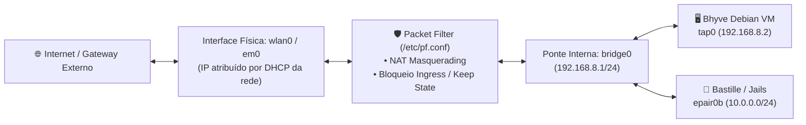

# 🛡️ Redes Físicas, NAT & Firewall Packet Filter (PF)

> Arquitetura de rede híbrida, interfaces virtuais (bridge/tap/epair), tradução de endereços (NAT) e regras estritas do Packet Filter no FreeBSD[cite: 7].

---

## 🧭 Visão Geral da Topologia de Rede

O FreeBSD atua simultaneamente como cliente de rede de alta velocidade (via Wi-Fi `wlan0` ou Ethernet `em0`) e como roteador interno para as camadas de isolamento (Bhyve e Jails)[cite: 7].



---

## 📐 Topologia de Sub-redes Internas

Para permitir que a máquina virtual Bhyve e as Jails acessem a internet através da interface Wi-Fi do host sem depender de roteamento bridge externo (que a maioria dos pontos de acesso Wi-Fi bloqueia devido à restrição de MAC address único), o host implementa uma **sub-rede interna privada com NAT**[cite: 7]:

| Interface           | Tipo    | Endereço IP             | Papel no Ecossistema                                       |
| :------------------ | :------ | :---------------------- | :--------------------------------------------------------- |
| **`wlan0` / `em0`** | Física  | Dinâmico (DHCP externo) | Saída para a internet e rede local física.                 |
| **`bridge0`**       | Virtual | `192.168.8.1/24`        | Gateway padrão para a sub-rede virtualizada.               |
| **`tap0`**          | Virtual | Conectada à `bridge0`   | Interface virtual da máquina virtual Debian Bhyve.         |
| **Debian VM**       | Guest   | `192.168.8.2/24`        | Host Linux dedicado para o Google Antigravity CLI (`agy`). |

---

## 🛡️ Configuração Canônica: `/etc/pf.conf`

O Packet Filter (PF) é habilitado no boot via `pf_load="YES"` no `/boot/loader.conf` e ativado com `pf_enable="YES"` no `/etc/rc.conf`[cite: 7].

### Regras Canônicas de NAT e Filtro

```text
ext_if = "wlan0"
vm_net = "192.168.8.0/24"

set skip on lo0
scrub in all fragment reassemble

nat on $ext_if from $vm_net to any -> ($ext_if)

block in all
pass out all keep state

pass on bridge0 from any to any
pass on tap0 from any to any

pass in on bridge0 proto tcp from 192.168.8.1 to 192.168.8.2 port 22 keep state
```

### Explicação das Regras do `/etc/pf.conf`:

- **`ext_if` e `vm_net`:** Macros que definem a interface externa (`wlan0`) e a sub-rede interna das máquinas virtuais (`192.168.8.0/24`)[cite: 7].
- **`set skip on lo0` e `scrub in all fragment reassemble`:** Opções de normalização e segurança que isentam a interface de loopback da filtragem e remontam pacotes fragmentados de entrada[cite: 7].
- **`nat on $ext_if from $vm_net to any -> ($ext_if)`:** Executa a Tradução de Endereço de Rede (NAT) para a VM Bhyve e Jails saírem para a internet pelo IP dinâmico da interface externa[cite: 7].
- **`block in all` e `pass out all keep state`:** Aplicam a política padrão de bloqueio restritivo de conexões de entrada e liberação de saída mantendo o estado da sessão[cite: 7].
- **`pass on bridge0` e `pass on tap0`:** Permitem tráfego irrestrito na rede virtual interna[cite: 7].
- **`pass in on bridge0 proto tcp ... port 22 keep state`:** Permite conexões SSH seguras originadas do host (`192.168.8.1`) para a VM (`192.168.8.2`)[cite: 7].

---

## 🎛️ Configuração de Interfaces no `/etc/rc.conf`

Para ativar o firewall PF, provisionar automaticamente a ponte virtual interna (`bridge0`) junto à interface `tap0` da VM Bhyve e habilitar o roteamento IP (`gateway_enable`) no host durante o boot[cite: 7]:

```sh
pf_enable="YES"
pf_rules="/etc/pf.conf"

cloned_interfaces="bridge0 tap0"
ifconfig_bridge0="inet 192.168.8.1/24 addm tap0 up"
ifconfig_tap0="up"

gateway_enable="YES"
```

---

## 🛠️ Comandos de Inspeção e Diagnóstico

1. **Validar sintaxe do arquivo de regras sem aplicar[cite: 7]:**

```sh
sudo pfctl -nf /etc/pf.conf
```

2. **Recarregar regras do firewall ativamente[cite: 7]:**

```sh
sudo pfctl -f /etc/pf.conf
```

3. **Listar regras de NAT ativas e contadores de pacotes[cite: 7]:**

```sh
sudo pfctl -s nat -v
```

4. **Inspecionar status das interfaces de rede virtuais[cite: 7]:**

```sh
ifconfig bridge0
ifconfig tap0
```

---

## 📶 Resiliência do Wi-Fi LinuxKPI (`rtw88`)

Em notebooks com placas de rede sem fio Realtek gerenciadas pela camada de compatibilidade LinuxKPI (`if_rtw88.ko`), o driver pode sofrer falhas de transição de estado (`lkpi_stop_hw_scan: failed to cancel scan: 35` / `error 95`) ao realizar varreduras em segundo plano (_background scanning_) enquanto já está associado a um ponto de acesso[cite: 7]. Essa falha corrompe a fila de envio e esgota o buffer de sockets (`send_packet: No buffer space available`)[cite: 7].

_(Nota: O aviso isolado `rtw880: lkpi_iv_newstate: error 95 during state transition 2 (AUTH) -> 2 (AUTH)` impresso no console durante o handshake WPA é um falso positivo benigno do `linuxkpi` e não derruba a sessão gráfica[cite: 1, 2].)_

### Mitigação Canônica no `/etc/rc.conf`:

Desativa-se a varredura contínua em segundo plano adicionando o parâmetro `-bgscan`[cite: 7]:

```sh
sudo sysrc ifconfig_wlan0="WPA DHCP -bgscan"
```

Caso a interface trave em tempo de execução, a pilha de rede pode ser reiniciada instantaneamente sem reiniciar a máquina[cite: 7]:

```sh
sudo service netif restart && sudo service routing restart
```
