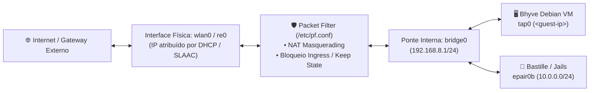

# 🛡️ Redes Físicas, NAT & Firewall Packet Filter (PF)

> Arquitetura de rede híbrida, interfaces virtuais (bridge/tap/epair), tradução de endereços (NAT) e regras estritas do Packet Filter no FreeBSD.

---

## 🧭 Visão Geral da Topologia de Rede

O FreeBSD atua simultaneamente como cliente de rede de alta velocidade (via Wi-Fi `wlan0` / `rtw880` ou Ethernet `re0`) e como roteador interno para as camadas de isolamento (Bhyve e Jails).



---

## 📐 Topologia de Sub-redes Internas

Para permitir que a máquina virtual Bhyve e as Jails acessem a internet através da interface ativa do host sem depender de roteamento bridge externo (que pontos de acesso Wi-Fi costumam bloquear devido à restrição de MAC address único), o host implementa uma **sub-rede interna privada com NAT** (regras endurecidas geradas por [`Setup/freebsd/container/bhyve.sh`](../../Setup/freebsd/container/bhyve.sh)):

| Interface           | Tipo    | Endereço IP             | Papel no Ecossistema                                                |
| :------------------ | :------ | :---------------------- | :------------------------------------------------------------------ |
| **`wlan0` / `re0`** | Física  | Dinâmico (DHCP externo) | Saída para a internet e rede local física.                          |
| **`bridge0`**       | Virtual | `192.168.8.1/24`        | Gateway padrão para a sub-rede virtualizada.                        |
| **`tap0`**          | Virtual | Conectada à `bridge0`   | Interface virtual da máquina virtual Debian Bhyve.                  |
| **Debian VM**       | Guest   | `192.168.8.0/24`        | Runtime Linux opcional sob demanda para workloads e containers OCI. |

---

## 🛡️ Configuração Canônica: `/etc/pf.conf`

O Packet Filter (PF) é habilitado no boot via `pf_load="YES"` no `/boot/loader.conf` e ativado com `pf_enable="YES"` no `/etc/rc.conf` (junto às regras de `pflog`, tabela `<bruteforce>`, `<lan_nets>`, `syncookies adaptive` e `urpf-failed` configuradas por `bhyve.sh`).

### Estrutura Simplificada de NAT e Filtro

```text
ext_if = "wlan0"
vm_net = "192.168.8.0/24"

set skip on lo0
scrub in all fragment reassemble

nat on $ext_if from $vm_net to any -> ($ext_if)

block in all
pass out all keep state

pass on bridge0 from any to any
pass on tap0 from any to any

pass in on bridge0 proto tcp from 192.168.8.1 to $vm_net port 22 keep state
```

### Explicação das Regras do `/etc/pf.conf`:

- **`ext_if` e `vm_net`:** Macros que definem a interface externa ativa e a sub-rede interna das máquinas virtuais (`192.168.8.0/24`).
- **`set skip on lo0` e `scrub in all fragment reassemble`:** Opções de normalização e segurança que isentam a interface de loopback da filtragem e remontam pacotes fragmentados de entrada.
- **`nat on $ext_if from $vm_net to any -> ($ext_if)`:** Executa a Tradução de Endereço de Rede (NAT) para a VM Bhyve e Jails saírem para a internet pelo IP dinâmico da interface externa.
- **`block in all` e `pass out all keep state`:** Aplicam a política padrão de bloqueio restritivo de conexões de entrada e liberação de saída mantendo o estado da sessão.
- **`pass on bridge0` e `pass on tap0`:** Permitem tráfego irrestrito na rede virtual interna.
- **`pass in on bridge0 proto tcp ... port 22 keep state`:** Permite conexões SSH seguras originadas do host (`192.168.8.1`) para a sub-rede virtualizada (`$vm_net`).

---

## 🎛️ Configuração de Interfaces no `/etc/rc.conf`

Para ativar o firewall PF, provisionar a ponte virtual (`bridge0`) com `tap0`, manter o DHCP em segundo plano (`background_dhclient="YES"`) e evitar travamento síncrono do `rtsol` no boot sem cabo (`inet6 auto_linklocal` + `rtsold_enable="NO"` gerenciado por `/usr/local/sbin/net-auto-switch`):

```sh
pf_enable="YES"
pf_rules="/etc/pf.conf"

background_dhclient="YES"
rtsold_enable="NO"

cloned_interfaces="bridge0 tap0"
ifconfig_bridge0="inet 192.168.8.1/24 addm tap0 up"
ifconfig_tap0="up"

gateway_enable="YES"
```

---

## 🛠️ Comandos de Inspeção e Diagnóstico

1. **Validar sintaxe do arquivo de regras sem aplicar:**

```sh
doas pfctl -nf /etc/pf.conf
```

2. **Recarregar regras do firewall ativamente:**

```sh
doas pfctl -f /etc/pf.conf
```

3. **Listar regras de NAT ativas e contadores de pacotes:**

```sh
doas pfctl -s nat -v
```

4. **Inspecionar status das interfaces de rede virtuais:**

```sh
ifconfig bridge0
ifconfig tap0
```

---

## 📶 Resiliência do Wi-Fi LinuxKPI (`rtw88`) & Isolamento Cabo/Wi-Fi

Em notebooks com placas Realtek gerenciadas pela camada LinuxKPI (`if_rtw88.ko`), a varredura contínua em segundo plano (_background scanning_) pode provocar falhas de fila (`send_packet: No buffer space available`), enquanto `ifconfig_<if>_ipv6="inet6 accept_rtadv"` trava o boot sem cabo no `rtsol(8)` e o `rtsold(8)` força `IFF_UP` em todas as interfaces da lista.

### Mitigação Canônica (`hosts/vostro3520-freebsd.sh`):

Desativa-se `-bgscan` no `wlan0`, utiliza-se `inet6 auto_linklocal` com `background_dhclient="YES"` e `rtsold_enable="NO"`, deixando `/usr/local/sbin/net-auto-switch` (acionado pelo serviço `net_isolation` e por eventos assíncronos `&` em `/usr/local/etc/devd/ethernet-wifi-isolation.conf`) ativar uma instância exclusiva de `rtsold -i -F -m` apenas na interface ativa (`re0` ou `wlan0`):

```sh
doas sysrc ifconfig_wlan0="WPA DHCP -bgscan"
doas sysrc ifconfig_re0_ipv6="inet6 auto_linklocal"
doas sysrc ifconfig_wlan0_ipv6="inet6 auto_linklocal"
doas sysrc background_dhclient="YES"
doas sysrc rtsold_enable="NO"
```

Para forçar a reavaliação da interface ativa em tempo de execução sem reiniciar a máquina:

```sh
doas /usr/local/sbin/net-auto-switch auto
```
