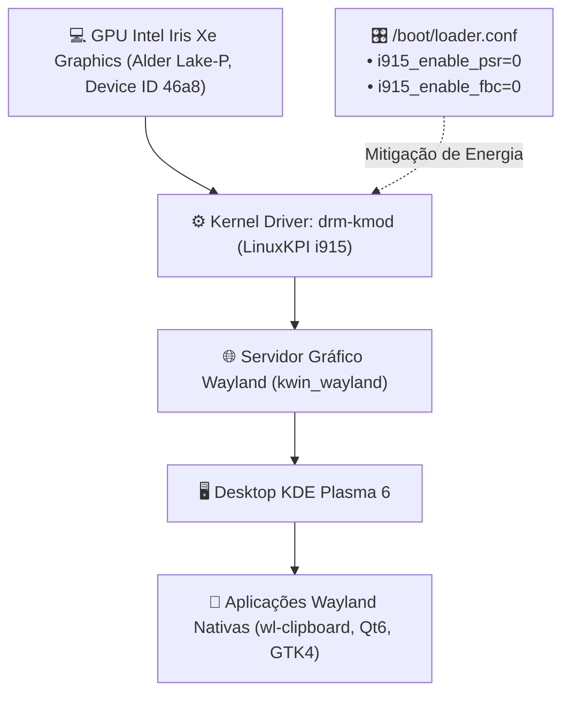

# 🖥️ Gráficos DRM & KDE Plasma 6 Wayland

> Arquitetura gráfica no FreeBSD, diagnóstico de drivers Intel Alder Lake-P (12ª Geração), mitigação de congelamentos por PSR/FBC e ambiente de desktop KDE Plasma 6 Wayland.

---

## 🧭 O Subsistema Gráfico no FreeBSD

A aceleração gráfica moderna no FreeBSD é implementada através do subsistema **`drm-kmod`** (Direct Rendering Manager). Esse subsistema utiliza a camada **LinuxKPI** do kernel do FreeBSD para compilar e executar diretamente os drivers DRM do kernel Linux (i915, amdgpu, radeon) sobre a arquitetura BSD.

O ambiente de desktop primário do Universal Environment é o **KDE Plasma 6** rodando nativamente sobre o protocolo de exibição moderno **Wayland** (`kwin_wayland`).



---

## 🔬 Diagnóstico de Hardware: Intel Alder Lake-P (12ª Geração)

A inspeção do buffer de mensagens do kernel (`dmesg`) revela a controladora de vídeo exata:

```text
drmn0: [drm] Found ALDERLAKE_P (device ID 46a8) display version 13.00 stepping D0
```

### A Anatomia dos Travamentos Silenciosos (Tela Preta com Backlight)

Em estações FreeBSD com processadores Intel Core de 12ª geração e desktop Wayland, a combinação de economia de energia agressiva do driver com o compositor KWin produz dois comportamentos críticos:

1. **Micro-travamentos do cursor do mouse (5 a 10s):** O controlador de display tenta forçar o painel interno a entrar em modo de suspensão profunda (_PSR2 - Panel Self Refresh_) a cada milissegundo ocioso. Quando o usuário move o mouse, o compositor Wayland envia novos quadros e o driver `i915` engasga para restabelecer a sincronia de clock com o display a tempo.
2. **Tela preta definitiva com backlight aceso:** Em determinado momento de oscilação de quadros, o driver perde o sinal de sincronia com a controladora e desliga a renderização. Para o kernel, o sistema operacional continua funcionando normalmente (sem registrar pânico ou erro no `/var/log/messages`), forçando o desligamento forçado pelo botão de energia.

---

## 🛡️ A Solução Definitiva no `/boot/loader.conf`

Para neutralizar a instabilidade do pipeline de energia nos gráficos Iris Xe Alder Lake, os parâmetros são aplicados no `/boot/loader.conf` via [`Setup/freebsd/desktop/system/system.sh`](../../Setup/freebsd/desktop/system/system.sh):

```text
# Default Intel Alder Lake Graphics (Previne perda de sinal e tela preta)
compat.linuxkpi.i915_enable_psr="0"
compat.linuxkpi.i915_enable_fbc="0"
```

- **`i915_enable_psr="0"`:** Desativa completamente o _Panel Self Refresh_. O painel interno opera com taxa de atualização constante, eliminando o lag do cursor do mouse e a perda de sinal.
- **`i915_enable_fbc="0"`:** Desativa a compressão do framebuffer (_Framebuffer Compression_), prevenindo falhas de memória gráfica e artefatos de renderização sob o Plasma 6.

---

## 📦 Stack de Pacotes Wayland & Desktop

Provisionado através da receita [`Setup/freebsd/desktop/gui/kde.sh`](../../Setup/freebsd/desktop/gui/kde.sh):

| Pacote                              | Função no Ecossistema                                                                                   |
| :---------------------------------- | :------------------------------------------------------------------------------------------------------ |
| **`graphics/drm-kmod`**             | Drivers de kernel para aceleração de vídeo Intel/AMD.                                                   |
| **`x11/plasma6-plasma-desktop`**    | Núcleo do ambiente gráfico KDE Plasma 6 Wayland.                                                        |
| **`x11/wl-clipboard`**              | Utilitários de linha de comando para manipular a área de transferência Wayland (`wl-copy`, `wl-paste`). |
| **`x11/xclip`**                     | Ponte de compatibilidade para aplicações legadas baseadas em XWayland.                                  |
| **`x11-themes/plasma6-breeze-gtk`** | Integração do tema visual Breeze em aplicações GTK (Firefox, VS Code).                                  |

---

## 🛠️ Comandos de Inspeção e Verificação

```sh
# 1. Checar se o driver i915 está ativo no kernel
kldstat | grep -i i915

# 2. Validar que o PSR foi desativado em tempo de voo
sysctl compat.linuxkpi.i915_enable_psr
# Saída esperada: compat.linuxkpi.i915_enable_psr: 0

# 3. Testar a área de transferência Wayland via CLI
echo "Universal Environment" | wl-copy
wl-paste
```
