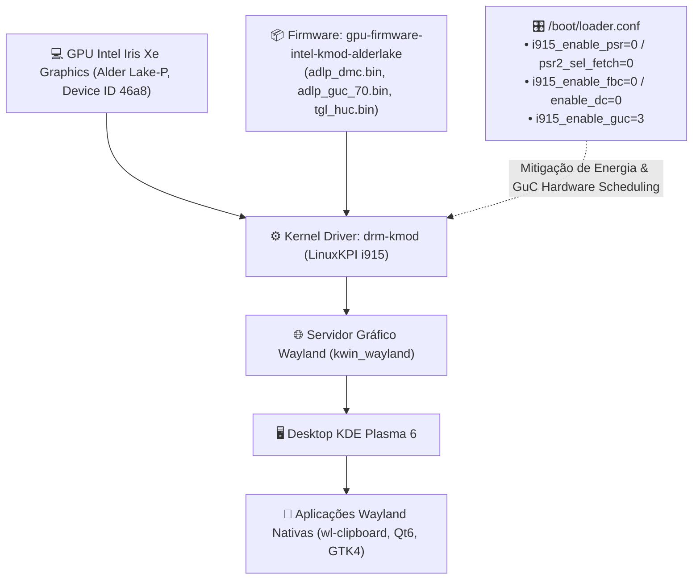

# 🖥️ Gráficos DRM & KDE Plasma 6 Wayland

> Arquitetura gráfica no FreeBSD, diagnóstico de drivers Intel Alder Lake-P (12ª Geração), mitigação de congelamentos por PSR/FBC/Preemption Timeout e ambiente de desktop KDE Plasma 6 Wayland[cite: 5].

---

## 🧭 O Subsistema Gráfico no FreeBSD

A aceleração gráfica moderna no FreeBSD é implementada através do subsistema **`drm-kmod`** (Direct Rendering Manager)[cite: 5]. Esse subsistema utiliza a camada **LinuxKPI** do kernel do FreeBSD para compilar e executar diretamente os drivers DRM do kernel Linux (i915, amdgpu, radeon) sobre a arquitetura BSD[cite: 5].

O ambiente de desktop primário do Universal Environment é o **KDE Plasma 6** rodando nativamente sobre o protocolo de exibição moderno **Wayland** (`kwin_wayland`)[cite: 5].



---

## 🔬 Diagnóstico de Hardware: Intel Alder Lake-P (12ª Geração)

A inspeção do buffer de mensagens do kernel (`dmesg`) revela a controladora de vídeo exata[cite: 5]:

```text
drmn0: [drm] Found ALDERLAKE_P (device ID 46a8) display version 13.00 stepping D0
```

### 1. A Anatomia dos Travamentos Silenciosos (Tela Preta com Backlight)

Em estações FreeBSD com processadores Intel Core de 12ª geração e desktop Wayland, a combinação de economia de energia agressiva do driver com o compositor KWin produz dois comportamentos críticos[cite: 5]:

1. **Micro-travamentos do cursor do mouse (5 a 10s):** O controlador de display tenta forçar o painel interno a entrar em modo de suspensão profunda (_PSR2 - Panel Self Refresh_) a cada milissegundo ocioso[cite: 5]. Quando o usuário move o mouse, o compositor Wayland envia novos quadros e o driver `i915` engasga para restabelecer a sincronia de clock com o display a tempo[cite: 5].
2. **Tela preta definitiva com backlight aceso:** Em determinado momento de oscilação de quadros, o driver perde o sinal de sincronia com a controladora e desliga a renderização[cite: 5]. Para o kernel, o sistema operacional continua funcionando normalmente (sem registrar pânico ou erro no `/var/log/messages`), forçando o desligamento pelo botão de energia[cite: 5].

### 2. A Anatomia do `GPU HANG` em Cascata (`preemption time out` no Motor `rcs0`)

Mesmo quando `psr=0`, `fbc=0` e `dc=0` estão ativos, deixar o escalonador **GuC** desativado (`compat.linuxkpi.i915_enable_guc: 0`) e o `psr2_sel_fetch: 1` ativo expõe o sistema ao travamento de preempção da fila 3D/Compute (`rcs0`)[cite: 1, 2]:

```text
drmn0: [drm] GPU HANG: ecode 12:1:85dfbfff, in Renderer [104348]
drmn0: [drm] Resetting rcs0 for preemption time out
drmn0: [drm] Renderer[104348] context reset due to GPU hang
drmn0: [drm] GPU HANG: ecode 12:1:85dfffff, in kwin_wayland [101380]
drmn0: [drm] Resetting rcs0 for preemption time out
drmn0: [drm] kwin_wayland[101380] context reset due to GPU hang
drmn0: [drm] GPU HANG: ecode 12:1:859ffffb, in QSGRenderThread [101660]
drmn0: [drm] Resetting rcs0 for preemption time out
drmn0: [drm] CanvasRenderer[104369] context reset due to GPU hang
drmn0: [drm] GPU HANG: ecode 12:1:86d8ffe0, in CanvasRenderer [104369]
```

- **O Gatilho (`Renderer` e `CanvasRenderer`):** Uma thread de renderização do navegador (WebGL/Canvas acelerado) ocupa a fila `rcs0` na GPU Intel Gen12 (`ecode 12:1`)[cite: 1, 2].
- **Falha de Preempção via CPU (`enable_guc=0`):** O compositor (`kwin_wayland`) e as threads gráficas do Qt (`QSGRenderThread`) solicitam preempção para desenhar o próximo quadro[cite: 1, 2]. Sem o microcontrolador GuC ativo, o escalonamento legado via CPU (_Execlists_) não consegue interromper a tarefa dentro do tempo limite do watchdog, disparando `Resetting rcs0 for preemption time out`[cite: 1, 2].
- **Efeito Dominó no Wayland:** Ao resetar o motor `rcs0` à força, os contextos gráficos do `kwin_wayland` e do `QSGRenderThread` que aguardavam na fila são invalidados em sequência, congelando a sessão Wayland[cite: 1, 2].

---

## 🛡️ A Solução Definitiva no `/boot/loader.conf`

Para neutralizar tanto a instabilidade do pipeline de energia (perda de sinal e tela preta) quanto o timeout de preempção do motor `rcs0` nos gráficos Iris Xe Alder Lake, os cinco parâmetros abaixo são aplicados no `/boot/loader.conf` via [`Setup/freebsd/desktop/system/system.sh`](../../Setup/freebsd/desktop/system/system.sh)[cite: 5]:

```text
compat.linuxkpi.i915_enable_psr="0"
compat.linuxkpi.i915_enable_psr2_sel_fetch="0"
compat.linuxkpi.i915_enable_fbc="0"
compat.linuxkpi.i915_enable_dc="0"
compat.linuxkpi.i915_enable_guc="3"
```

- **`i915_enable_psr="0"` e `i915_enable_psr2_sel_fetch="0"`:** Desativam completamente o _Panel Self Refresh_ e a busca seletiva do _PSR2_[cite: 5]. O painel interno opera com taxa de atualização constante, eliminando o lag do cursor do mouse e a perda de sinal[cite: 5].
- **`i915_enable_fbc="0"`:** Desativa a compressão do framebuffer (_Framebuffer Compression_), prevenindo falhas de memória gráfica e artefatos de renderização sob o Plasma 6[cite: 5].
- **`i915_enable_dc="0"`:** Desativa os estados de dormência profunda da GPU (_Display C-states: DC5/DC6_)[cite: 5].
- **`i915_enable_guc="3"`:** Ativa o microcontrolador de escalonamento via hardware **GuC** (`1`: _GuC submission_, preempção nativa de filas e controle de frequência _SLPC_) somado à autenticação **HuC** (`2`: aceleração de mídia VA-API)[cite: 5]. Transfere o gerenciamento de preempção do software (_execlists_) diretamente para o silício da GPU[cite: 5].

> [!TIP]
> **Prevenção complementar no Firefox:** Para evitar que elementos `<canvas>` 2D mal otimizados em páginas web sobrecarreguem o processo `CanvasRenderer` na fila `rcs0`[cite: 1, 2], defina `gfx.canvas.accelerated = false` no `about:config` (sem impacto em WebGL ou decodificação de vídeo VA-API).

---

## 📦 Stack de Pacotes Wayland, DRM & Firmware

Provisionado através das receitas do subsistema desktop[cite: 5]:

| Pacote                                           | Função no Ecossistema                                                                                            |
| :----------------------------------------------- | :--------------------------------------------------------------------------------------------------------------- |
| **`graphics/drm-kmod`**                          | Metapacote de drivers de kernel (`drm-61-kmod`) para aceleração de vídeo Intel/AMD[cite: 3, 5].                  |
| **`graphics/gpu-firmware-intel-kmod-alderlake`** | Binários de microcódigo essenciais para 12ª Geração (`adlp_dmc.bin`, `adlp_guc_70.bin`, `tgl_huc.bin`).          |
| **`x11/plasma6-plasma-desktop`**                 | Núcleo do ambiente gráfico KDE Plasma 6 Wayland[cite: 5].                                                        |
| **`x11/wl-clipboard`**                           | Utilitários de linha de comando para manipular a área de transferência Wayland (`wl-copy`, `wl-paste`)[cite: 5]. |
| **`x11/xclip`**                                  | Ponte de compatibilidade para aplicações legadas baseadas em XWayland[cite: 5].                                  |
| **`x11-themes/plasma6-breeze-gtk`**              | Integração do tema visual Breeze em aplicações GTK (Firefox, VS Code)[cite: 5].                                  |

---

## 🛠️ Comandos de Inspeção e Verificação Pós-Boot

1. **Checar se o módulo `i915kms` e o pacote de firmware Alder Lake estão presentes[cite: 5]:**

```sh
kldstat | grep -i i915
pkg info | grep gpu-firmware-intel-kmod-alderlake
```

2. **Validar todas as flags do `i915` em tempo de voo e a ativação do GuC/HuC no `dmesg`:**

```sh
sysctl compat.linuxkpi.i915_enable_psr compat.linuxkpi.i915_enable_psr2_sel_fetch compat.linuxkpi.i915_enable_fbc compat.linuxkpi.i915_enable_dc compat.linuxkpi.i915_enable_guc && dmesg | grep -iE "drmn0|guc|huc"
```

### Saída Esperada (Estado Saudável Canônico):

```text
compat.linuxkpi.i915_enable_psr: 0
compat.linuxkpi.i915_enable_psr2_sel_fetch: 0
compat.linuxkpi.i915_enable_fbc: 0
compat.linuxkpi.i915_enable_dc: 0
compat.linuxkpi.i915_enable_guc: 3
drmn0: <drmn> on vgapci0
drmn0: [drm] Found ALDERLAKE_P (device ID 46a8) display version 13.00 stepping D0
drmn0: successfully loaded firmware image 'i915/adlp_dmc.bin'
drmn0: [drm] Finished loading DMC firmware i915/adlp_dmc.bin (v2.20)
drmn0: successfully loaded firmware image 'i915/adlp_guc_70.bin'
drmn0: successfully loaded firmware image 'i915/tgl_huc.bin'
drmn0: [drm] GT0: GuC firmware i915/adlp_guc_70.bin version 70.49.4
drmn0: [drm] GT0: HuC firmware i915/tgl_huc.bin version 7.9.3
drmn0: [drm] GT0: HuC: authenticated for all workloads
drmn0: [drm] GT0: GUC: submission enabled
drmn0: [drm] GT0: GUC: SLPC enabled
drmn0: [drm] GT0: GUC: RC enabled
[drm] Initialized i915 1.6.0 for drmn0 on minor 0
```

3. **Testar a área de transferência Wayland via CLI[cite: 5]:**

```sh
echo "Universal Environment" | wl-copy
wl-paste
```
