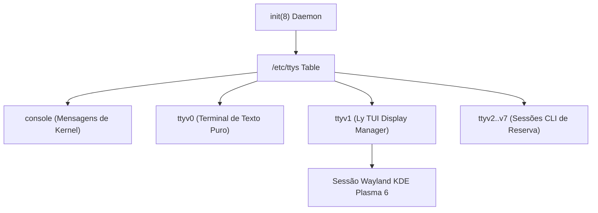

# 🔲 Consoles Virtuais, TTYs & Ly Display Manager

> Governança dos consoles virtuais do FreeBSD no `/etc/ttys`, formatação simétrica de 5 colunas, fontes de alta resolução Spleen e gerenciador de login Ly TUI[cite: 8].

---

## 🧭 Arquitetura dos Terminais Virtuais no FreeBSD

O FreeBSD gerencia os consoles de texto físicos e virtuais através do arquivo `/etc/ttys` e do daemon de inicialização `init(8)`[cite: 8]. Ao contrário do Linux moderno (onde consoles são instanciados dinamicamente via `systemd-logind`), o FreeBSD adota uma tabela estrita e previsível de dispositivos de terminal[cite: 8]:

- **`console`:** Console do sistema operacional utilizado durante single-user mode e logs de pânico[cite: 8].
- **`ttyv0`:** Primeiro console virtual acessível via `Ctrl + Alt + F1`[cite: 8].
- **`ttyv1`:** Terminal virtual reservado para o **Ly Display Manager** (gerenciador gráfico/TUI)[cite: 8].
- **`ttyv2` a `ttyv7`:** Terminais virtuais independentes para login direto em linha de comando (`Alt + F3` a `Alt + F8`)[cite: 8].
- **`ttyu0` a `ttyu3`:** Portas seriais físicas e virtuais[cite: 8].



---

## 📐 O Contrato das 5 Colunas no `/etc/ttys`

O arquivo `/etc/ttys` é processado pela biblioteca de sistema `getttyent(3)`[cite: 8]. Cada linha de configuração ativa contém exatamente cinco campos principais[cite: 8]:

1. **`name` (Largura: 7 caracteres):** Identificador do dispositivo de terminal (`console`, `ttyv0`, `ttyu0`, `xc0`)[cite: 8].
2. **`getty` (Largura: 31 caracteres):** O comando ou classe do `gettytab` a ser invocado (ex: `"/usr/libexec/getty Pc"`, `"/usr/libexec/getty Ly"`, `none`)[cite: 8].
3. **`type` (Largura: 7 caracteres):** Emulação do terminal para a variável `$TERM` (`xterm`, `vt100`, `unknown`)[cite: 8].
4. **`status` (Largura: 10 caracteres):** Estado de ativação (`on`, `off`, `onifexists`, `onifconsole`)[cite: 8].
5. **`comments` (Restante da linha):** Nível de segurança e flags de controle (`secure`, `insecure`)[cite: 8].

---

## 🗄️ Tabela Canônica Formatada

Quando formatado pelo utilitário [`Setup/freebsd/desktop/system/ttys.sh`](../../Setup/freebsd/desktop/system/ttys.sh), o `/etc/ttys` atinge simetria geométrica absoluta, organizando em sequência o console principal (`console`), os terminais virtuais (`ttyv0` a `ttyv8`), os terminais seriais (`ttyu0` a `ttyu3`), o dumb console (`dcons`), o console virtual Xen (`xc0`) e o console RISC-V HTIF (`rcons`)[cite: 8]:

```text
console none                            unknown off        secure
ttyv0   "/usr/libexec/getty Pc"         xterm   onifexists secure
ttyv1   "/usr/libexec/getty Ly"         xterm   on         secure
ttyv2   "/usr/libexec/getty Pc"         xterm   onifexists secure
ttyv3   "/usr/libexec/getty Pc"         xterm   onifexists secure
ttyv4   "/usr/libexec/getty Pc"         xterm   onifexists secure
ttyv5   "/usr/libexec/getty Pc"         xterm   onifexists secure
ttyv6   "/usr/libexec/getty Pc"         xterm   onifexists secure
ttyv7   "/usr/libexec/getty Pc"         xterm   onifexists secure
ttyv8   "/usr/local/bin/xdm -nodaemon"  xterm   off        secure
ttyu0   "/usr/libexec/getty 3wire"      vt100   onifconsole secure
ttyu1   "/usr/libexec/getty 3wire"      vt100   onifconsole secure
ttyu2   "/usr/libexec/getty 3wire"      vt100   onifconsole secure
ttyu3   "/usr/libexec/getty 3wire"      vt100   onifconsole secure
dcons   "/usr/libexec/getty std.115200" vt100   off        secure
xc0     "/usr/libexec/getty Pc"         xterm   onifconsole secure
rcons   "/usr/libexec/getty std.115200" vt100   onifconsole secure
```

---

## 🔲 Ly TUI Display Manager

O **Ly** é um display manager moderno de interface em modo texto (TUI) com animações matriciais, suporte a Wayland e consumo irrisório de memória RAM (< 5 MB contra 150 MB do SDDM ou GDM)[cite: 8].

### Mecanismo de Inicialização:

1. No FreeBSD, o Ly não roda como serviço autônomo do `rc.d`; ele é instanciado diretamente pelo `init(8)` sobre o terminal virtual `ttyv1`[cite: 8].
2. A linha `ttyv1 "/usr/libexec/getty Ly" xterm on secure` instrui o `init` a invocar o `getty` com a classe `Ly`[cite: 8].
3. O `/etc/gettytab` redireciona a classe `Ly` para executar o binário `/usr/local/bin/ly`[cite: 8].
4. Ao autenticar com sucesso, o Ly dispara a sessão do KDE Plasma 6 Wayland (`startplasma-wayland`)[cite: 8].

---

## 🔤 Fontes Spleen & Cursor Estático no Console `vt(4)`

Em telas de alta densidade (HD, Full HD e 4K), as fontes padrão de 8x16 do console de texto do FreeBSD ficam desproporcionais[cite: 8].

O ecossistema provisiona fontes **Spleen 12x24** nítidas no `/etc/rc.conf` via [`Setup/freebsd/desktop/system/system.sh`](../../Setup/freebsd/desktop/system/system.sh)[cite: 8]:

```sh
allscreens_flags="-f spleen-12x24"
```

A fonte bitmap `spleen-12x24` garante o equilíbrio métrico ideal entre legibilidade e densidade de colunas/linhas em qualquer monitor.

> [!NOTE]
> No FreeBSD moderno com driver `vt(4)`, o cursor é **intrinsecamente estático por arquitetura de kernel** (`sys/dev/vt/vt_core.c`), desenhado diretamente como um bloco invertido no framebuffer sem temporizador de pisque. Parâmetros legados como `vidcontrol -c normal,noblink` pertenciam ao antigo driver `sc(4)` dos anos 90 e são obsoletos/incompatíveis com `vt(4)`.

---

## 🛠️ Comandos de Manutenção

1. **Executar auto-alinhamento canônico do `/etc/ttys`[cite: 8]:**

```sh
sudo sh ~/Documents/Environment/Setup/freebsd/desktop/system/ttys.sh
```

2. **Recarregar serviço de console e aplicar fontes em runtime[cite: 8]:**

```sh
sudo service syscons restart
```

3. **Recarregar tabela de TTYs sem reiniciar o sistema operacional[cite: 8]:**

```sh
sudo kill -HUP 1
```

4. **Testar fonte Spleen na sessão ativa do console[cite: 8]:**

```sh
vidcontrol -f /usr/share/vt/fonts/spleen-12x24.fnt
```
