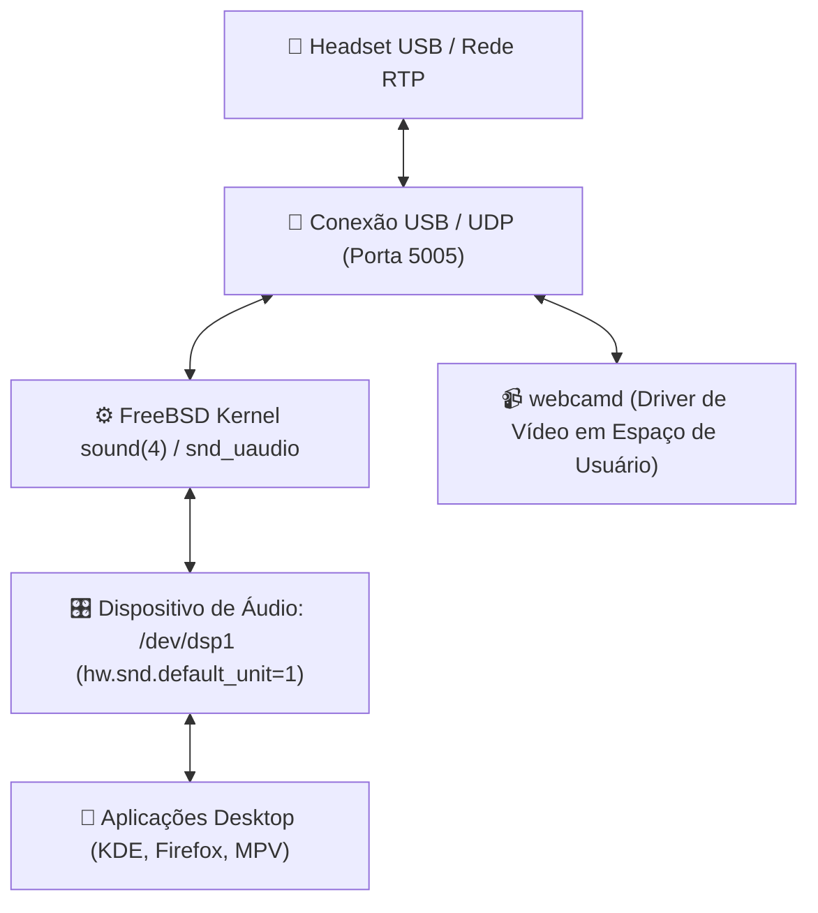

# 🎙️ Áudio USB, Microfone & Periféricos

> Governança do subsistema de áudio no FreeBSD (`sound(4)`), roteamento RTP, daemon de webcam em espaço de usuário (`webcamd`) e permissões seguras no `devfs`.

---

## 🧭 O Subsistema de Áudio do FreeBSD (`sound(4)`)

O FreeBSD possui uma arquitetura de áudio determinística e de baixa latência. O driver genérico `sound(4)` gerencia canais virtuais de mixagem de hardware (_VCHANS_) nativamente via `/dev/dsp*`, integrando-se opcionalmente ao `sndiod` em estações desktop.

_(Nota: Caso o PulseAudio seja invocado por aplicações sob Wayland, o aviso `pulseaudio: Failed to load module "module-x11-xsmp"` indica apenas que o módulo de gerenciamento de sessão legado do X11 foi ignorado por não haver sessão Xorg ativa, sem afetar o áudio.)_



---

## 🎛️ Identificação e Seleção da Placa Primária

Para inspecionar as interfaces de som ativas no hardware:

```sh
cat /dev/sndstat
```

Exemplo de saída típica:

```text
Installed devices:
pcm0: <Realtek ALC256 (Internal Analog)> (play/rec)
pcm1: <Realtek ALC256 / Headset> (play/rec) default
pcm2: <Intel AlderLake HDMI Audio> (play)
```

### Configuração Persistente no Perfil de Hardware (`hosts/vostro3520-freebsd.sh`)

Enquanto `Setup/freebsd/desktop/system/system.sh` mantém o áudio portátil (`sndiod`), ajustes específicos de índice de dispositivo são isolados no perfil opt-in [`Setup/hosts/vostro3520-freebsd.sh`](../../Setup/hosts/vostro3520-freebsd.sh), que fixa `hw.snd.default_unit=1` no `/etc/sysctl.conf`, zera canais não usados em `dev.pcm.2` e blinda hooks de `virtual_oss` no `devd`:

```text
hw.snd.default_unit=1
dev.pcm.2.mixer.vol_0_0.val=0
dev.pcm.2.mixer.vol_0_1.val=0
```

---

## 📱 Roteamento de Áudio Híbrido (RTP / OSS)

Para utilizar um dispositivo móvel Android em rede local como receptor ou microfone auxiliar de baixa latência sobre OSS:

- **Reprodução em rede (Host $\rightarrow$ Celular):** captura do fluxo `/dev/dsp` com envio RTP para aplicativos compatíveis (ex.: _Simple Protocol Player_).
- **Entrada de microfone (Celular $\rightarrow$ Host):** recepção UDP/RTP (porta `5005`) injetada em dispositivo virtual (`virtual_oss` / `/dev/dsp`) para consumo em navegadores e videoconferências.

---

## 📹 Webcam em Espaço de Usuário (`webcamd`)

No FreeBSD, drivers de webcam USB não rodam dentro do anel do kernel. O daemon **`multimedia/webcamd`** encapsula os drivers Video4Linux (V4L2) estritamente em **espaço de usuário** utilizando `/dev/cuse`:

- Se uma câmera USB enviar quadros corrompidos ou desconectar abruptamente, apenas o daemon em userspace reinicia, preservando a estabilidade do kernel.

### Habilitação no `/etc/rc.conf`:

Provisionado via [`Setup/freebsd/desktop/devices/webcam.sh`](../../Setup/freebsd/desktop/devices/webcam.sh):

```sh
webcamd_enable="YES"
```

---

## 🔒 Permissões do Sistema de Arquivos de Dispositivos (`devfs`)

Para permitir que o usuário comum opere câmeras, áudio e captura de pacotes Wireshark sem elevar privilégios administrativos:

### Grupos Canônicos do Usuário:

O usuário do sistema é adicionado aos grupos `wheel`, `operator`, `video` e `webcamd` por `Setup/freebsd/desktop/system/system.sh`:

```sh
doas pw groupmod video -m "$(id -un)"
doas pw groupmod webcamd -m "$(id -un)"
```

### Regras no `/etc/devfs.rules`:

Garantem que os nós `/dev/video*`, `/dev/cuse*` e `/dev/bpf*` pertençam aos grupos corretos:

```text
[system=10]
add path 'video*' mode 0660 group video
add path 'cuse*' mode 0660 group webcamd
add path 'bpf*' mode 0660 group network
```

---

## 🛠️ Comandos de Verificação

1. **Inspecionar status dos misturadores de volume:**

```sh
mixer
```

2. **Verificar se o `webcamd` detectou a câmera conectada:**

```sh
doas webcamd -l
```

3. **Testar gravação e reprodução curta de áudio:**

```sh
cat /dev/dsp > /tmp/teste.raw
cat /tmp/teste.raw > /dev/dsp
```
