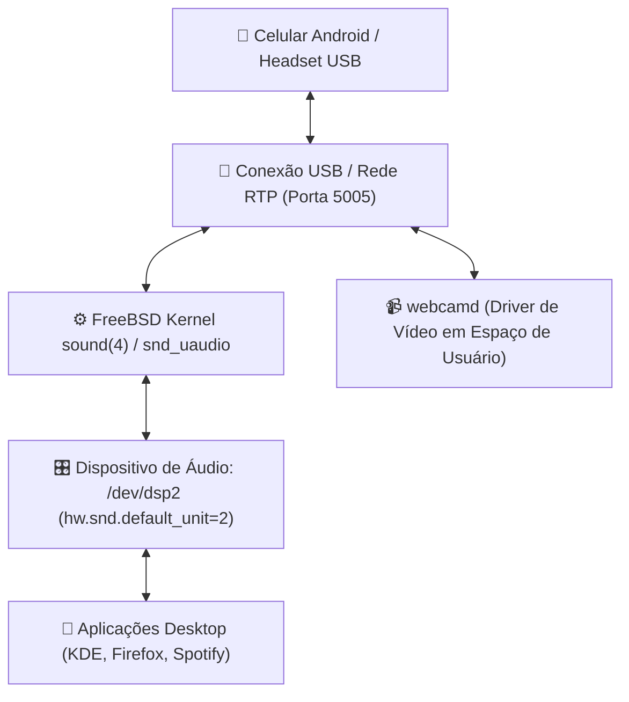

# 🎙️ Áudio USB, Microfone & Periféricos

> Governança do subsistema de áudio no FreeBSD, roteamento USB/RTP para dispositivos móveis, daemon de webcam em espaço de usuário (`webcamd`) e permissões seguras no `devfs`[cite: 9].

---

## 🧭 O Subsistema de Áudio do FreeBSD (`sound(4)`)

O FreeBSD possui uma das arquiteturas de áudio mais determinísticas e de baixa latência do mundo UNIX[cite: 9]. O driver genérico `sound(4)` gerencia canais virtuais de mixagem de hardware (_VCHANS_) sem requerer camadas intermediárias pesadas como PipeWire ou PulseAudio para tarefas básicas[cite: 9].

_(Nota: Caso o PulseAudio seja invocado por aplicações sob Wayland, o aviso `pulseaudio: Failed to load module "module-x11-xsmp"` exibido no console indica apenas que o módulo de gerenciamento de sessão legado do X11 foi ignorado por não haver sessão Xorg ativa, sem afetar o áudio[cite: 1, 2].)_



---

## 🎛️ Identificação e Seleção da Placa Primária

Para inspecionar as interfaces de som ativas no hardware[cite: 9]:

```sh
cat /dev/sndstat
```

Exemplo de saída típica[cite: 9]:

```text
Installed devices:
pcm0: <Realtek ALC256 (Internal Analog)> (play/rec)
pcm1: <Intel AlderLake HDMI Audio> (play)
pcm2: <USB Audio Device> (play/rec) default
```

### Configuração Persistente da Saída USB

O dispositivo USB (`pcm2`) é fixado como padrão no `/etc/sysctl.conf` através da receita [`Setup/freebsd/desktop/system/system.sh`](../../Setup/freebsd/desktop/system/system.sh)[cite: 9]:

```text
hw.snd.default_unit=2
dev.pcm.2.mixer.vol_0_0.val=0
dev.pcm.2.mixer.vol_0_1.val=0
```

---

## 📱 Roteamento de Áudio Híbrido: Estação $\leftrightarrow$ Celular

Em estações onde o desenvolvedor deseja utilizar o celular Android como caixa de som de alta fidelidade ou microfone sem fio de alta qualidade[cite: 9]:

### 1. Roteamento de Som do Sistema para o Celular

Provisionado via [`Setup/freebsd/desktop/devices/audio.sh`](../../Setup/freebsd/desktop/devices/audio.sh)[cite: 9]:

- Captura o fluxo de reprodução do `/dev/dsp` e transmite via protocolo RTP (Real-time Transport Protocol) sob baixa latência para o endereço IP do smartphone conectado via USB tethering[cite: 9].

### 2. Microfone do Celular para o FreeBSD

Provisionado via [`Setup/freebsd/desktop/devices/microphone.sh`](../../Setup/freebsd/desktop/devices/microphone.sh)[cite: 9]:

- Escuta pacotes RTP na porta UDP `5005` emitidos por aplicações móveis de streaming de voz e injeta o áudio em um dispositivo virtual `/dev/dsp` para ser consumido por navegadores, Discord ou videoconferências[cite: 9].

---

## 📹 Webcam em Espaço de Usuário (`webcamd`)

No FreeBSD, drivers de webcam USB **não rodam dentro do anel do kernel**[cite: 9]. Por motivos de estabilidade e segurança cibernética, o FreeBSD adota o daemon **`multimedia/webcamd`**[cite: 9]:

- O `webcamd` encapsula os drivers Video4Linux (V4L2) do kernel Linux e os executa estritamente em **espaço de usuário** (_user space_) utilizando a camada de caracteres `/dev/cuse`[cite: 9].
- Se uma câmera USB travar ou enviar pacotes corrompidos, apenas o processo isolado do `webcamd` reinicia, garantindo que o kernel do FreeBSD nunca entre em pânico[cite: 9].

### Habilitação no `/etc/rc.conf`:

Provisionado via [`Setup/freebsd/desktop/devices/webcam.sh`](../../Setup/freebsd/desktop/devices/webcam.sh)[cite: 9]:

```sh
webcamd_enable="YES"
```

---

## 🔒 Permissões do Sistema de Arquivos de Dispositivos (`devfs`)

Para permitir que o usuário comum opere câmeras, áudio e captura de pacotes Wireshark sem elevar privilégios com `sudo`[cite: 9]:

### Grupos Canônicos do Usuário:

O usuário do sistema deve ser membro dos grupos `operator`, `video`, `webcamd` e `wheel`[cite: 9]:

```sh
sudo pw groupmod video -m gabrielf
sudo pw groupmod webcamd -m gabrielf
```

### Regras no `/etc/devfs.rules`:

Garantem que os nós `/dev/video*`, `/dev/cuse*` e `/dev/bpf*` pertençam aos grupos corretos[cite: 9]:

```text
[system=10]
add path 'video*' mode 0660 group video
add path 'cuse*' mode 0660 group webcamd
add path 'bpf*' mode 0660 group network
```

---

## 🛠️ Comandos de Verificação

1. **Inspecionar status dos misturadores de volume[cite: 9]:**

```sh
mixer
```

2. **Verificar se o `webcamd` detectou a câmera conectada[cite: 9]:**

```sh
sudo webcamd -l
```

3. **Testar gravação e reprodução curta de áudio (grave falando ao microfone por 3 segundos, pressione `Ctrl+C` e em seguida reproduza o arquivo gerado)[cite: 9]:**

```sh
cat /dev/dsp > /tmp/teste.raw
cat /tmp/teste.raw > /dev/dsp
```
