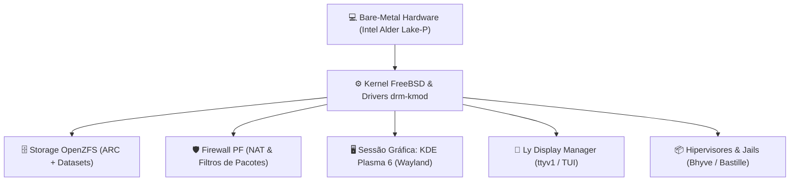

# 💻 Host FreeBSD Desktop: Arquitetura & Governança

> Documentação canônica do sistema operacional bare-metal, estação de trabalho gráfica e hipervisor hospedeiro no Universal Environment.

---

## 🧭 Visão Geral & Filosofia do Host

O **FreeBSD 15-CURRENT** opera como a **espinha dorsal soberana** do ambiente de Gabriel Frigo. Ele roda diretamente sobre o hardware bare-metal, provendo estabilidade de nível corporativo, resiliência de dados via OpenZFS e segurança avançada de rede através do Packet Filter (PF).

Em vez de depender de distribuições Linux monolíticas como desktop primário, o ecossistema adota o FreeBSD para:

1. **Controle Absoluto de Recursos:** Governança determinística de memória física dividida matematicamente entre o cache ARC do ZFS (4/8), o host gráfico (3/8) e o runtime virtual Bhyve (1/8).
2. **Imunidade de Dados (ZFS Nativo):** Proteção integral contra corrupção silenciosa de dados (_bit rot_), compressão transparente ZSTD e snapshots atômicos de todo o sistema.
3. **Isolamento em Camadas:** O host atua como base para virtualização Tipo-2 (Bhyve) e containers nativos de sistema (Jails e BastilleBSD), mantendo ferramentas invasivas isoladas de processos críticos.



---

## 📚 Índice da Seção

| Arquivo                                                                      | Título                             | Foco Operacional                                                                             |
| :--------------------------------------------------------------------------- | :--------------------------------- | :------------------------------------------------------------------------------------------- |
| **[`01-kernel-boot-e-loader.md`](01-kernel-boot-e-loader.md)**               | Inicialização, Loader & Kernel     | `/boot/loader.conf`, inicialização modular de drivers e parâmetros em `/etc/sysctl.conf`.    |
| **[`02-zfs-storage-e-arc.md`](02-zfs-storage-e-arc.md)**                     | Storage ZFS & Governança ARC       | Estrutura de datasets, particionamento de memória (4/8), snapshots periódicos e integridade. |
| **[`03-redes-e-firewall-pf.md`](03-redes-e-firewall-pf.md)**                 | Redes Físicas, NAT & Firewall PF   | Interfaces Wi-Fi/Ethernet, pontes virtuais, NAT e regras restritivas do Packet Filter.       |
| **[`04-graficos-drm-e-wayland.md`](04-graficos-drm-e-wayland.md)**           | Gráficos DRM & KDE Wayland         | Intel 12ª Geração (Iris Xe), mitigação de congelamentos por PSR/FBC e Plasma 6.              |
| **[`05-consoles-e-display-managers.md`](05-consoles-e-display-managers.md)** | Consoles Virtuais, TTYs & Ly DM    | Formatação simétrica em 5 colunas do `/etc/ttys`, Ly TUI Display Manager e fontes Spleen.    |
| **[`06-dispositivos-e-audio.md`](06-dispositivos-e-audio.md)**               | Áudio USB, Microfone & Periféricos | Roteamento de áudio USB (`hw.snd`), captura via RTP, serviço `webcamd` e devfs rulesets.     |

---

## ⚡ Comandos Rápidos & Sanity Check

```sh
# Verificar versão do kernel e sistema
uname -a
# Inspecionar uso de memória ARC do ZFS e estado da RAM
arcstat 2
# Inspecionar status dos gráficos Intel drmn0
dmesg | grep -iE 'drmn|alderlake|iris'
# Checar regras ativas do firewall Packet Filter
sudo pfctl -sr -v
# Validar alinhamento das terminais virtuais
bat -r 26:35 /etc/ttys
```
