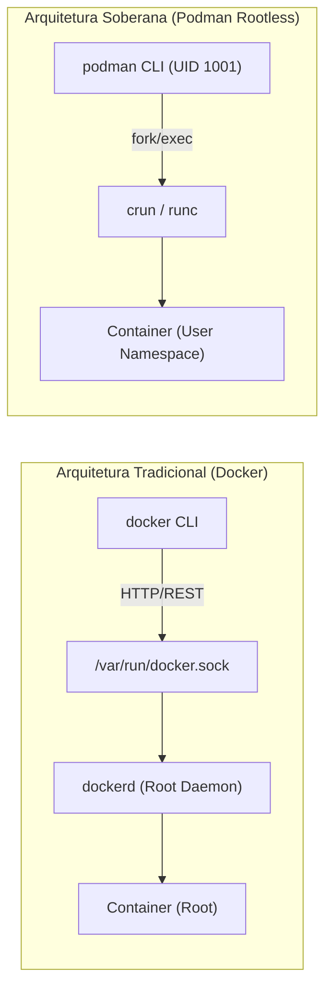

# 📦 Containers OCI & Podman Rootless

> Governança de containers no Linux com arquitetura sem daemon, execução rootless via namespaces de usuário e compatibilidade Docker.

---

## 🧭 Por que Podman em vez de Docker Daemon?

Historicamente, o Docker popularizou o padrão de containers através de uma arquitetura baseada em um daemon central (`dockerd`) executando com privilégios irrestritos de `root`. Qualquer usuário com acesso ao socket `/var/run/docker.sock` possui controle total sobre o kernel da máquina.

No Universal Environment, adota-se o **Podman (Pod Manager)** pelos seguintes motivos de engenharia:

1. **Daemonless (Filosofia UNIX Pura):** O Podman não depende de um daemon residente em background. Containers são instanciados como filhos diretos do processo atual (`fork/exec`), facilitando integração com `systemd`, `cron` e supervisores de processo.
2. **Rootless por Padrão:** Containers rodam inteiramente no contexto do usuário comum (`UID=1001`), utilizando _User Namespaces_ do Linux. Mesmo se um processo malicioso escapar do container, ele terá apenas os privilégios limitados do usuário no host.
3. **Compatibilidade 100% OCI:** O Podman consome imagens dos mesmos registros (Docker Hub, Quay, GitHub Container Registry) e compartilha a sintaxe de comandos com a CLI do Docker.



---

## ⚙️ Configuração de User Namespaces: `subuid` e `subgid`

Para que o usuário possa mapear UIDs internos do container sem ser root, o sistema operacional necessita de faixas alocadas em `/etc/subuid` e `/etc/subgid`:

```text
# /etc/subuid e /etc/subgid
gabrielf:100000:65536
```

Para aplicar e inicializar as faixas:

```sh
# Migrar namespaces do usuário se alterados recentemente
podman system migrate
```

---

## 🔌 Emulação do Docker Socket para Ferramentas Externas

Determinadas ferramentas de build e IDEs esperam a presença física de um soquete compatível com a API Docker. O Podman disponibiliza um soquete exclusivo por usuário:

```sh
# Ativar o socket do Podman no escopo do usuário atual (não-root)
systemctl --user enable --now podman.socket

# Exportar a variável de ambiente para que ferramentas identifiquem o socket
export DOCKER_HOST="unix://${XDG_RUNTIME_DIR}/podman/podman.sock"
```

---

## 🚀 Operação Cotidiana & Podman Compose

### Aliases Transparentes no Shell:

No Universal Shell (`Shell/`), o Podman é exposto naturalmente:

```sh
alias docker="podman"
alias docker-compose="podman-compose"
```

### Comandos de Gestão:

```sh
# Executar container efêmero para testes interativos
podman run --rm -it alpine:latest /bin/sh

# Listar containers em execução e finalizados
podman ps -a

# Inspecionar uso de disco e recursos
podman system df

# Limpar containers e imagens órfãs (Zero-Bloat)
podman system prune -af
```
