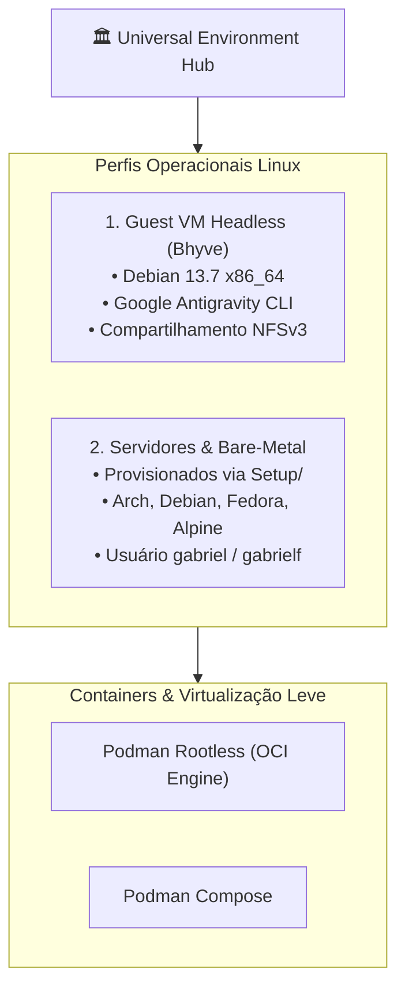

# 🐧 Linux Runtimes & Containers: Governança do Ecossistema GNU/Linux

> Documentação canônica sobre os runtimes Linux no Universal Environment, interoperabilidade POSIX/GNU, paridade de usuários e containers OCI via Podman.

---

## 🧭 O Papel do Linux no Universal Environment

No ecossistema de Gabriel Frigo, o GNU/Linux desempenha um papel cirúrgico e de alta precisão: ele **não substitui o host FreeBSD**, mas atua como **motor especializado de execução** para ferramentas que demandam syscalls proprietárias ou ecossistemas modernos de containers.

Existem dois perfis operacionais de Linux governados pelo Environment:

1. **Linux Runtime Headless (Guest Bhyve):** Instância Debian 13 mínima operando em VM acoplada ao host FreeBSD (`192.168.8.2`), conectada via NFSv3 e despachada de forma transparente pelo terminal (`linux-host`, `agy`).
2. **Estações Bare-Metal Nativas:** Servidores e estações Linux completas provisionadas pelas receitas automatizadas do `Setup/linux/` (Debian, Arch, Fedora, Void e Alpine).



---

## 📚 Índice da Seção

| Arquivo                                                        | Título                           | Foco Operacional                                                                                       |
| :------------------------------------------------------------- | :------------------------------- | :----------------------------------------------------------------------------------------------------- |
| **[`01-paridade-posix-e-gnu.md`](01-paridade-posix-e-gnu.md)** | Paridade POSIX/GNU & Identidade  | Sincronia de UID/GID 1001, convenções XDG Base Directory, montagens de home e compatibilidade BSD/GNU. |
| **[`02-containers-e-podman.md`](02-containers-e-podman.md)**   | Containers OCI & Podman Rootless | Execução de containers sem daemon e sem root, soquetes Podman, subuid/subgid e compatibilidade Docker. |

---

## ⚡ Comandos Rápidos & Sanity Check

```sh
# Verificar versão da distribuição, kernel e arquitetura
uname -srm
cat /etc/os-release

# Validar paridade de identidade do usuário
id -u; id -g

# Checar saúde do subsistema de containers Podman Rootless
podman info

# Inspecionar montagem e permissões do compartilhamento NFSv3
df -hT /home/gabrielf
```
