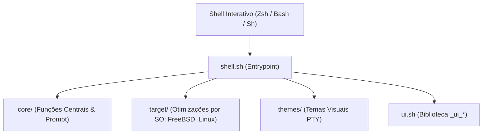

# 🐚 Shell: Motor Interativo de Terminal & Prompts Ultra-Rápidos

> Documentação canônica do Universal Shell: arquitetura modular multi-shell, prompts com latência inferior a 16ms e a biblioteca semântica de emissão `_ui_*`.

---

## 🧭 O Papel do Shell no Ecossistema

O repositório **Shell** é o **motor interativo do usuário**. Ele transforma qualquer terminal cru em um ambiente ágil, produtivo e visualmente unificado, sem degradar a velocidade do interpretador.

### Invariantes Centrais do Shell:

1. **Latência de Prompt Imperceptível (< 16ms):** Um dos maiores problemas de ferramentas populares (Oh-My-Zsh, Starship) é a lentidão ao renderizar novos prompts. O Universal Shell executa todas as checagens de git e renderização em menos de 16 milissegundos (medido formalmente via `benchmark.sh`).
2. **Matriz de Interpretadores Suportada:** Arquitetura desacoplada que multiplexa código entre **Zsh**, **Bash**, **FreeBSD `/bin/sh`** e **OpenBSD `ksh`**.
3. **Erradicação de Falsos Positivos de Git:** Utilização exclusiva de `git status --porcelain=v1` com `GIT_OPTIONAL_LOCKS=0`, imune a inconsistências de timestamps (_stat-cache_) causadas por ferramentas em background.



---

## 🎨 A Biblioteca Universal de Emissão Semântica (`_ui_*`)

O Shell padroniza a saída visual de status de todos os scripts do ecossistema através de rotinas semânticas ricas:

| Função                | Finalidade Visual                         | Cor / Prefixo                    |
| :-------------------- | :---------------------------------------- | :------------------------------- |
| `_ui_banner "TITULO"` | Régua de destaque para títulos principais | Ciano / Moldura de 60 caracteres |
| `_ui_step "Mensagem"` | Início de etapa operacional               | Ciano (`:: `)                    |
| `_ui_sub "Detalhe"`   | Sub-etapa de uma operação em andamento    | Cinza (` ──`)                    |
| `_ui_ok "Sucesso"`    | Conclusão bem-sucedida de etapa           | Verde (` ✅` ou `[OK]`)          |
| `_ui_warn "Aviso"`    | Alerta não-bloqueante                     | Amarelo (` ⚠️` ou `[AVISO]`)     |
| `_ui_err "Falha"`     | Erro impeditivo                           | Vermelho (` ❌` ou `[ERRO]`)     |
| `_ui_info "Nota"`     | Informação contextual                     | Azul (` ℹ️` ou `[INFO]`)         |

---

## 🌐 Adaptação Dinâmica de Prompt & Propagação TTY via SSH

O Universal Shell detecta dinamicamente a natureza do terminal conectado:

- **Sessões Gráficas PTY (KDE Plasma, Wayland, X11):** Em emuladores modernos com fontes Nerd Fonts, renderiza a cápsula gráfica rica (`pill.sh`, `multi.sh`).
- **Consoles Puros TTY (FreeBSD `ttyv*`, Linux `/dev/tty*`):** Em consoles virtuais sem fontes Nerd Fonts (ex: fontes Spleen/VGA), comuta automaticamente para o layout ASCII estruturado sem glifos quebrados.

### Propagação Automática via SSH & Multiplexadores:

Quando o usuário dispara comandos remotos a partir de um console TTY puro (via `lx`/`linux-host`, `agy`, `personal-server`, `venture-server` ou `ssh`), o cliente injeta e propaga `LC_RAW_TTY=1` e `RAW_TTY=1` através da infraestrutura OpenSSH (`AcceptEnv LANG LC_*` e `-o SetEnv`). O servidor remoto identifica a condição do terminal do cliente e renderiza o prompt TTY limpo, prevenindo caixas pretas e caracteres corrompidos (_mojibake_). A mesma herança protege painéis internos do **tmux** e **zellij**.

---

## ⚡ Suíte de Benchmarks de Performance (`benchmark.sh`)

O Shell mantém sua própria ferramenta de medição estatística de latência, executada automaticamente antes de novos commits:

```sh
sh Shell/benchmark.sh
```

A ferramenta avalia:

- **Latência de Inicialização do Shell:** Tempo de carga a frio e a quente do interpretador.
- **Latência de Navegação Interativa (`cd`):** Custo dos hooks de diretório (`zoxide`, `chpwd`).
- **Latência de Renderização de Prompt:** Custo do cálculo dinâmico de git dirty e formatação ANSI.

---

## 🪟 Lançadores Gráficos Efêmeros & Sessões Multi-TTY (`gui`)

Uma das inovações de resiliência do Universal Shell é o modelo de **processos gráficos efêmeros por TTY**, eliminando a dependência de Display Managers monolíticos:

### Separação Arquitetural: Quiosque (`gui` / `xgui`) vs Gestão de Janelas (`wm` / `xwm` / `exwm` / `ewm`)

- **Quiosque Mono-Aplicação (`(x/w)gui`):** Focado no ciclo de vida de uma única aplicação principal (`gui firefox`, `xgui gimp`), mantendo suporte transparente a caixas de diálogo modais e subjanelas efêmeras. Ao encerrar o aplicativo, o compositor é descarregado e o terminal virtual retorna imediatamente ao prompt de texto.
- **Window Management Completo (`(x/w)wm`, `exwm`, `ewm`):** Sessão gráfica persistente por terminal virtual com gerenciador de janelas completo, barra de status modular, menus com tema escuro e barramentos D-Bus com isolamento estrito entre diferentes terminais TTY.

### Identidade Visual GTK4/Qt6 & Pipeline de Fontes

O ambiente gráfico adota uma paleta inspirada no **Adwaita Dark (GTK4)** e **Breeze Dark (Qt6)**:

- Fundo inativo / base: `#1e1e22`
- Superfície ativa / barras: `#2b2b30`
- Borda e seleção ativa (azul): `#3584e4`
- Borda e destaques de saída (vermelho): `#e01b24`
- Texto secundário: `#9a9996`

A função interna `_resolve_desktop_font` resolve tipografias através de um pipeline determinístico:

1. `JetBrainsMono Nerd Font` (preferência primária universal se detectada via `fc-list`).
2. Resolução por ambiente desktop configurado:
    - **KDE / Plasma:** `Noto Sans`
    - **GNOME:** `Adwaita Sans` $\rightarrow$ `Cantarell`
    - **MATE / Cinnamon / XFCE:** `Ubuntu` $\rightarrow$ `DejaVu Sans`
3. Fallback universal: `Sans`.

### Gerenciamento de Janelas: `wwm` (Wayland) e `xwm` (X11)

- **`wwm` (Wayland Window Manager):** Despacha sessões Wayland puras (`sway`, `labwc`, `river` ou `cage` com terminal `foot`). No Sway, acopla o script `wwm-status` que gera uma barra de status interativa em formato JSON (`"click_events": true`), com botões clicáveis: `[Web Browser]`, `[Terminal]`, `[Files]`, `[Emacs]`, `[Menu]`, `[Close]`, `[Exit]` e indicador de data/hora.
- **`xwm` (X11 Window Manager):** Inicia sessão gráfica sobre Openbox sem depender de painéis pesados. Gera dinamicamente um menu raiz contextual com:
    - Aplicações fixas de acesso rápido: `Web Browser`, `Terminal`, `Files`, `Emacs`.
    - 5 categorias indexadas dinamicamente via varredura de arquivos `.desktop`: `Development`, `Internet`, `Office`, `Media & Graphics`, `System & Tools`.
    - Comandos operacionais: `Reconfigure` e `Exit`.

### Quiosques Efêmeros: `wgui` e `xgui`

- **`wgui` (Wayland Kiosk com Abas Inteligentes):** Opera sobre o Sway executando o daemon sentinela `wgui-tabwatch`. Quando há apenas uma aplicação em tela, aplica `layout splith, border none` para visual limpo em tela cheia. Quando uma janela secundária é disparada (total $\ge 2$), comuta automaticamente para `layout tabbed, border normal 1`, apresentando abas auto-ocultáveis na borda superior.
- **`xgui` (X11 Kiosk Declarativo):** Opera sobre Openbox com tema de alto contraste. Configura regras estáticas em XML (`<application type="normal"><decor>no</decor><maximized>yes</maximized></application>`), eliminando completamente loops em background de redimensionamento (`xdotool`), prevenindo condições de corrida e congelamento de renderização.

### Emacs OS: `ewm` (Wayland) e `exwm` (X11)

- **`ewm` (Emacs Wayland Manager):** Executa o GNU Emacs compilado com backend Wayland nativo (PGTK) sob thread Smithay/Rust. Opera com `tool-bar` desabilitada por padrão (`tool-bar-lines 0`), garantindo visual limpo e preservando a área de trabalho para buffers e janelas de clientes Wayland.
- **`exwm` (Emacs X Window Manager):** Opera sob X11 puro com comutação contextual de simulação de teclas:
    - `emacs/wm-gui-simulation-keys`: mapeia atalhos usuais de Emacs para eventos padrão de desktop (ex: `C-y` para colar, `M-w` para copiar, `C-f`/`C-b` para setas).
    - `emacs/wm-terminal-simulation-keys`: preserva teclas de controle do terminal (`C-c`, `C-z`, `C-d`, `C-l`), alternando dinamicamente com base na classe da janela (`exwm-class-name`).

### Resolução Antifrágil de Aplicativos

Ao despachar aplicativos gráficos ou utilitários via linha de comando, o lançador percorre uma cascata determinística de resolução:
`Binário Nativo no PATH` $\rightarrow$ `Flatpak (flatpak run)` $\rightarrow$ `Snap` $\rightarrow$ `AppImage` $\rightarrow$ `/opt/app` $\rightarrow$ `Camadas de Compatibilidade (FreeBSD Linuxulator / VM Bhyve / macOS / MSYS2)`.

### Comutação de Userland & Hypervisor NetBSD

- **Comando `userland`:** Permite alternar os binários e bibliotecas da sessão interativa entre toolchains:
    - `userland gnu` (ou `gnu`): Prioriza utilitários GNU (`gnubin`, binários com prefixo `g*`).
    - `userland bsd` (ou `bsd`): Restaura o ambiente BSD padrão (`bmake`, `bsdtar`, `mandoc`).
    - `userland default` (ou `default`): Retorna à ordem nativa do sistema hospedeiro.
    - `userland status`: Exibe a configuração ativa.
- **Comando `nb` (NetBSD VM):** Wrapper para gerenciamento da máquina virtual NetBSD sob o hipervisor Bhyve (no FreeBSD) ou KVM (no Linux), oferecendo controle de ciclo de vida (`nb -s`, `nb`, `nb -c`) e conexão remota transparente.
