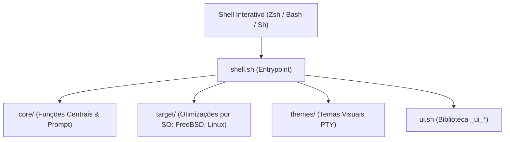

# 🐚 Shell: Motor Interativo de Terminal & Prompts Ultra-Rápidos

> Documentação canônica do Universal Shell: arquitetura modular multi-shell, prompts com latência inferior a 16ms e a biblioteca semântica de emissão `_ui_*`.

---

## 🧭 O Papel do Shell no Ecossistema

O repositório **Shell** é o **motor interativo do usuário**. Ele transforma qualquer terminal cru em um ambiente ágil, produtivo e visualmente unificado, sem degradar a velocidade do interpretador.

### Invariantes Centrais do Shell:

1. **Latência de Prompt Imperceptível (< 16ms):** Um dos maiores problemas de ferramentas populares (Oh-My-Zsh, Starship) é a lentidão ao renderizar novos prompts. O Universal Shell executa todas as checagens de git e renderização em menos de 16 milissegundos (medido formalmente via `benchmark.sh`).
2. **Matriz de Interpretadores Suportada:** Arquitetura desacoplada que multiplexa código entre **Zsh**, **Bash**, **FreeBSD `/bin/sh`** e **OpenBSD `ksh`**.
3. **Erradicação de Falsos Positivos de Git:** Utilização exclusiva de `git status --porcelain=v1` com `GIT_OPTIONAL_LOCKS=0`, imune a inconsistências de timestamps (_stat-cache_) causadas por ferramentas em background.



---

## 🎨 A Biblioteca Universal de Emissão Semântica (`_ui_*`)

O Shell padroniza a saída visual de status de todos os scripts do ecossistema através de rotinas semânticas ricas:

| Função                | Finalidade Visual                         | Cor / Prefixo                    |
| :-------------------- | :---------------------------------------- | :------------------------------- |
| `_ui_banner "TITULO"` | Régua de destaque para títulos principais | Ciano / Moldura de 60 caracteres |
| `_ui_step "Mensagem"` | Início de etapa operacional               | Ciano (`:: `)                    |
| `_ui_sub "Detalhe"`   | Sub-etapa de uma operação em andamento    | Cinza (` ──`)                    |
| `_ui_ok "Sucesso"`    | Conclusão bem-sucedida de etapa           | Verde (` ✅` ou `[OK]`)          |
| `_ui_warn "Aviso"`    | Alerta não-bloqueante                     | Amarelo (` ⚠️` ou `[AVISO]`)     |
| `_ui_err "Falha"`     | Erro impeditivo                           | Vermelho (` ❌` ou `[ERRO]`)     |
| `_ui_info "Nota"`     | Informação contextual                     | Azul (` ℹ️` ou `[INFO]`)         |

---

## ⚡ Suíte de Benchmarks de Performance (`benchmark.sh`)

O Shell mantém sua própria ferramenta de medição estatística de latência, executada automaticamente antes de novos commits:

```sh
# Executar medição completa de latência de inicialização e navegação
sh Shell/benchmark.sh
```

A ferramenta avalia:

- **Latência de Inicialização do Shell:** Tempo de carga a frio e a quente do interpretador.
- **Latência de Navegação Interativa (`cd`):** Custo dos hooks de diretório (`zoxide`, `chpwd`).
- **Latência de Renderização de Prompt:** Custo do cálculo dinâmico de git dirty e formatação ANSI.
