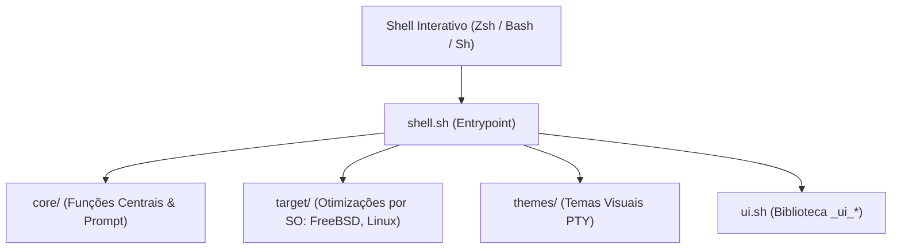

# 🐚 Shell: Motor Interativo de Terminal & Prompts Ultra-Rápidos

> Documentação canônica do Universal Shell: arquitetura modular multi-shell, prompts com latência inferior a 16ms e a biblioteca semântica de emissão `_ui_*`.

---

## 🧭 O Papel do Shell no Ecossistema

O repositório **Shell** é o **motor interativo do usuário**. Ele transforma qualquer terminal cru em um ambiente ágil, produtivo e visualmente unificado, sem degradar a velocidade do interpretador.

### Invariantes Centrais do Shell:

1. **Latência de Prompt Imperceptível (< 16ms):** Um dos maiores problemas de ferramentas populares (Oh-My-Zsh, Starship) é a lentidão ao renderizar novos prompts. O Universal Shell executa todas as checagens de git e renderização em menos de 16 milissegundos (medido formalmente via `benchmark.sh`).
2. **Matriz de Interpretadores Suportada:** Arquitetura desacoplada que multiplexa código entre **Zsh**, **Bash**, **FreeBSD `/bin/sh`** e **OpenBSD `ksh`**.
3. **Erradicação de Falsos Positivos de Git:** Utilização exclusiva de `git status --porcelain=v1` com `GIT_OPTIONAL_LOCKS=0`, imune a inconsistências de timestamps (_stat-cache_) causadas por ferramentas em background.



---

## 🎨 A Biblioteca Universal de Emissão Semântica (`_ui_*`)

O Shell padroniza a saída visual de status de todos os scripts do ecossistema através de rotinas semânticas ricas:

| Função                | Finalidade Visual                         | Cor / Prefixo                    |
| :-------------------- | :---------------------------------------- | :------------------------------- |
| `_ui_banner "TITULO"` | Régua de destaque para títulos principais | Ciano / Moldura de 60 caracteres |
| `_ui_step "Mensagem"` | Início de etapa operacional               | Ciano (`:: `)                    |
| `_ui_sub "Detalhe"`   | Sub-etapa de uma operação em andamento    | Cinza (` ──`)                    |
| `_ui_ok "Sucesso"`    | Conclusão bem-sucedida de etapa           | Verde (` ✅` ou `[OK]`)          |
| `_ui_warn "Aviso"`    | Alerta não-bloqueante                     | Amarelo (` ⚠️` ou `[AVISO]`)     |
| `_ui_err "Falha"`     | Erro impeditivo                           | Vermelho (` ❌` ou `[ERRO]`)     |
| `_ui_info "Nota"`     | Informação contextual                     | Azul (` ℹ️` ou `[INFO]`)         |

---

## 🌐 Adaptação Dinâmica de Prompt & Propagação TTY via SSH

O Universal Shell detecta dinamicamente a natureza do terminal conectado:

- **Sessões Gráficas PTY (KDE Plasma, Wayland, X11):** Em emuladores modernos com fontes Nerd Fonts, renderiza a cápsula gráfica rica (`pill.sh`, `multi.sh`).
- **Consoles Puros TTY (FreeBSD `ttyv*`, Linux `/dev/tty*`):** Em consoles virtuais sem fontes Nerd Fonts (ex: fontes Spleen/VGA), comuta automaticamente para o layout ASCII estruturado sem glifos quebrados.

### Propagação Automática via SSH & Multiplexadores:

Quando o usuário dispara comandos remotos a partir de um console TTY puro (via `lx`/`linux-host`, `agy`, `personal-server`, `venture-server` ou `ssh`), o cliente injeta e propaga `LC_RAW_TTY=1` e `RAW_TTY=1` através da infraestrutura OpenSSH (`AcceptEnv LANG LC_*` e `-o SetEnv`). O servidor remoto identifica a condição do terminal do cliente e renderiza o prompt TTY limpo, prevenindo caixas pretas e caracteres corrompidos (_mojibake_). A mesma herança protege painéis internos do **tmux** e **zellij**.

---

## ⚡ Suíte de Benchmarks de Performance (`benchmark.sh`)

O Shell mantém sua própria ferramenta de medição estatística de latência, executada automaticamente antes de novos commits:

```sh
# Executar medição completa de latência de inicialização e navegação
sh Shell/benchmark.sh
```

A ferramenta avalia:

- **Latência de Inicialização do Shell:** Tempo de carga a frio e a quente do interpretador.
- **Latência de Navegação Interativa (`cd`):** Custo dos hooks de diretório (`zoxide`, `chpwd`).
- **Latência de Renderização de Prompt:** Custo do cálculo dinâmico de git dirty e formatação ANSI.

---

## 🪟 Lançadores Gráficos Efêmeros & Sessões Multi-TTY (`gui`)

Uma das inovações mais antifrágeis do Universal Shell é o conceito de **processos gráficos efêmeros por TTY**, eliminando a dependência de Display Managers monolíticos (GDM, SDDM):

- **Isolamento por Terminal Virtual:** Permite subir uma sessão gráfica isolada atrelada a um TTY específico via `gui [app]` (Wayland nativo) ou `xgui [app]` (Xorg). Ao fechar a aplicação, o compositor é finalizado e o terminal retorna imediatamente ao prompt de texto limpo.
- **Concorrência Multi-Ambiente:** O usuário pode rodar `gui -k firefox` no TTY2 (KDE Plasma), `gui foot` no TTY3 (GNOME Adwaita) e alternar entre eles instantaneamente via `Ctrl+Alt+F*`.
- **Modo Quiosque Soberano na Tétrade Wayland:**
    - **Sway:** Opera com regras efêmeras de tela cheia automática (`fullscreen enable`), garantindo que novas janelas ocupem o display inteiro sem fatiar o espaço visual em 50/50, com suporte a troca de TTY (`Ctrl+Alt+F*`).
    - **Labwc:** Gera `rc.xml` efêmero com `<windowRule identifier="*" serverDecoration="no"><action name="Maximize"/></windowRule>`, maximizando janelas sem bordas nem decorações.
    - **River:** Opera sem o gerador de tiling (`rivertile`), impedindo o fatiamento da tela, abrindo views no topo com tecla rápida `Super+F` para fullscreen.
    - **Cage:** Mantido como último fallback defensivo de quiosque puro mono-aplicação.
- **Paridade Estrita no X11 (`xgui` com `xterm`, `xrdb` e Cascata de Quiosque):** O XTerm herda idêntica paleta Adwaita Dark, fontes `JetBrainsMono Nerd Font` e padding de 16px via injeção efêmera de `Xresources` no `xinit`, abrindo com `-maximized`. Qualquer aplicativo adicional (Firefox, VLC, GIMP) é gerenciado por uma cascata de micro-WMs de quiosque (`matchbox-window-manager` > `openbox` efêmero com maximização total > `cwm` nativo do OpenBSD > `ratpoison` > micro-daemon de `xdotool`).
- **Suporte Soberano a Emacs Wayland Manager (`ewm` / `wewm`):** O Shell reconhece o `ewm` como compositor nativo via `_has_wayland` (`_emacs="ewm"` e presença de `libewm_core.so`), suportando thread nativa Rust Smithay e degradação graciosa para quiosque Wayland caso o binário não esteja presente.
