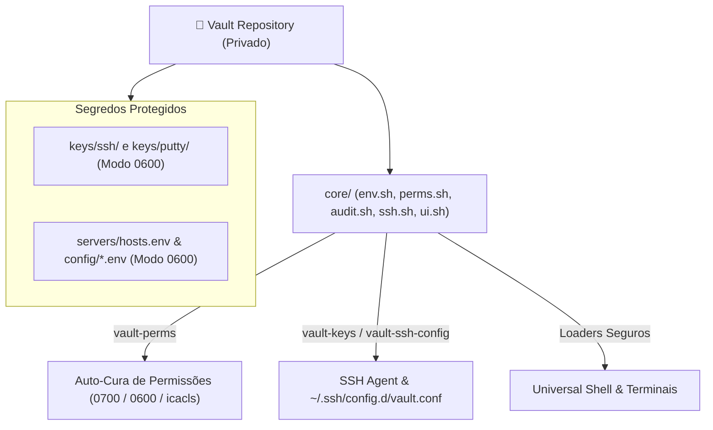

# 🔐 Vault: O Cofre Criptográfico Privado

> Documentação canônica do Vault: isolamento de segredos, permissões canônicas 0700/0600, loaders multi-shell seguros e a política de vazamento zero.

---

## 🧭 O Papel do Vault no Ecossistema

O repositório **Vault** é o **cofre criptográfico de segurança**. Ele armazena chaves privadas SSH, credenciais de servidores, tokens de API e certificados sensíveis de Gabriel Frigo.

### Invariantes Fundamentais do Vault:

1. **Repositório Estritamente Privado:** O Vault nunca é publicado ou exposto publicamente. No repositório Environment, sua pasta é ignorada pelo `.gitignore` e clonada defensivamente sob demanda (`make clone`).
2. **Permissões Canônicas Octais Rígidas:** Nenhum segredo é carregado se as permissões no sistema de arquivos estiverem incorretas:
    - Diretórios e scripts/hooks executáveis do cofre: **`0700`** (`rwx------`).
    - Chaves (`keys/ssh/*.key`, `keys/ssh/*.pub`, `keys/putty/*.ppk`), bibliotecas (`core/*.sh`), loaders e arquivos `.env`: **`0600`** (`rw-------`).
3. **Loaders Multi-Shell Seguros:** O Vault disponibiliza rotinas de carregamento de variáveis de ambiente, auditoria e agente SSH compatíveis com POSIX `sh`/Bash/Zsh, Fish, PowerShell, Nushell, CMD e Lua/Clink sem exportar segredos fictícios.
4. **Filtro Estrito de Templates & Exemplos:** Todo carregador do Vault (`vault.sh`, `vault.fish`, `vault.ps1`, `vault.cmd`, `vault.nu`, `vault.lua`) ignora obrigatoriamente arquivos que contenham `template` ou `example` no nome. Isso impede categoricamente que segredos fictícios ou placeholders (ex: `GITHUB_TOKEN="ghp_XXX..."`) vazem para a sessão e interfiram em ferramentas do ecossistema como `git`, `got` e `gh`.



---

## 🛡️ Auto-Cura de Permissões (`vault-perms`)

O utilitário `vault-perms` (implementado em `core/perms.sh`) é executado automaticamente pelo hook de atualização (`upvt`) ou pode ser acionado manualmente.

### Comportamento em Sistemas UNIX (FreeBSD / Linux):

```sh
chmod 0700 "${HOME}/.local/share/vault"
chmod 0700 "${HOME}/.local/share/vault/keys" "${HOME}/.local/share/vault/keys/ssh" "${HOME}/.local/share/vault/keys/putty"
chmod 0600 "${HOME}/.local/share/vault/keys/ssh/"* "${HOME}/.local/share/vault/keys/putty/"*
```

### Comportamento no Windows (PowerShell / MSYS2):

Invoca rotinas de `icacls` para quebrar a herança de ACLs e conceder acesso exclusivo ao usuário conectado, bloqueando acessos indevidos de contas de serviço.

---

## 🔑 Injeção Transparente de Chaves SSH (`vault-keys` & `vault-ssh-config`)

Quando uma nova sessão de terminal é instanciada (com invalidação automática via `ssh_keys_sig` ao adicionar ou alterar chaves):

1. Verifica se o `ssh-agent` já está residente na memória do sistema operacional.
2. Caso inativo, instancia o agente e exporta as variáveis `$SSH_AUTH_SOCK` e `$SSH_AGENT_PID`.
3. Atualiza `~/.ssh/config.d/vault.conf` e `~/.ssh/config` (`Include config.d/vault.conf`), vinculando `github.key` ao host `github.com` (habilitando `git` e `got` via SSH).
4. Adiciona chaves privadas de `keys/ssh/*.key` comparando fingerprints SHA256 para evitar duplicatas e removendo chaves obsoletas do Vault.
