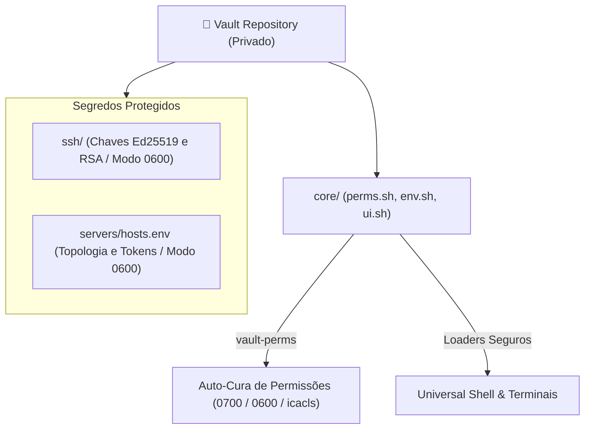

# 🔐 Vault: O Cofre Criptográfico Privado

> Documentação canônica do Vault: isolamento de segredos, permissões canônicas 0700/0600, loaders multi-shell seguros e a política de vazamento zero.

---

## 🧭 O Papel do Vault no Ecossistema

O repositório **Vault** é o **cofre criptográfico de segurança**. Ele armazena chaves privadas SSH, credenciais de servidores, tokens de API e certificados sensíveis de Gabriel Frigo.

### Invariantes Fundamentais do Vault:

1. **Repositório Estritamente Privado:** O Vault nunca é publicado ou exposto publicamente. No repositório Environment, sua pasta é ignorada pelo `.gitignore` e clonada defensivamente sob demanda (`make clone`).
2. **Permissões Canônicas Octais Rígidas:** Nenhum segredo é carregado se as permissões no sistema de arquivos estiverem incorretas:
    - Diretórios do cofre: **`0700`** (`rwx------`).
    - Chaves privadas e arquivos sensíveis: **`0600`** (`rw-------`).
    - Chaves públicas: **`0644`** (`rw-r--r--`).
3. **Loaders Multi-Shell Seguros:** O Vault disponibiliza rotinas de carregamento de variáveis de ambiente e agentes SSH compatíveis com Bash, Zsh, POSIX Sh, PowerShell e Nushell sem exportar variáveis para subprocessos não autorizados.



---

## 🛡️ Auto-Cura de Permissões (`vault-perms`)

O utilitário `vault-perms` (implementado em `core/perms.sh`) é executado automaticamente pelo hook de inicialização do Shell ou pode ser acionado manualmente.

### Comportamento em Sistemas UNIX (FreeBSD / Linux):

```sh
# Aplica permissões octais determinísticas
chmod 0700 ~/.local/share/vault
chmod 0700 ~/.local/share/vault/ssh
chmod 0600 ~/.local/share/vault/ssh/id_*
chmod 0644 ~/.local/share/vault/ssh/*.pub 2>/dev/null || true
```

### Comportamento no Windows (PowerShell / MSYS2):

Invoca rotinas de `icacls` para quebrar a herança de ACLs e conceder acesso exclusivo ao usuário conectado, bloqueando acessos indevidos de contas de serviço.

---

## 🔑 Injeção Transparente de Chaves SSH

Quando uma nova sessão de terminal é instanciada, o módulo do Vault:

1. Verifica se o `ssh-agent` já está residente na memória do sistema operacional.
2. Caso inativo, instancia o agente e exporta as variáveis `$SSH_AUTH_SOCK` e `$SSH_AGENT_PID`.
3. Adiciona as chaves privadas ao agente de forma segura sem requerer a duplicação dos arquivos para a pasta padrão `~/.ssh/`.
