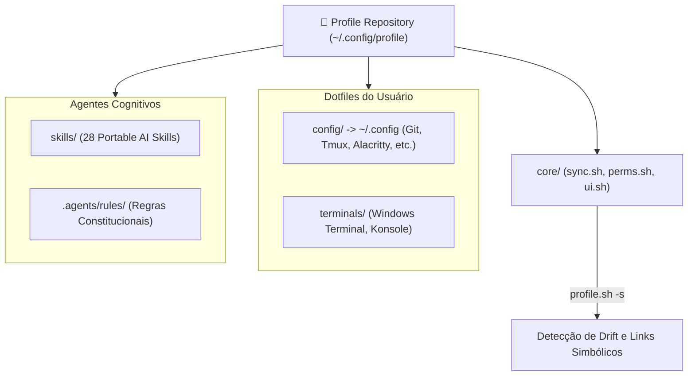

# 👤 Profile: Identidade, Dotfiles Declarativos & AI Skills

> Documentação canônica do Universal Profile: governança de dotfiles no `$HOME`, links simbólicos seguros, XDG Base Directory e o catálogo de Portable AI Skills.

---

## 🧭 O Papel do Profile no Ecossistema

O repositório **Profile** é a **identidade do usuário**. Ele cuida de tudo o que define as preferências pessoais, atalhos, configurações visuais de ferramentas e capacidades cognitivas de inteligência artificial de Gabriel Frigo no espaço do usuário (`$HOME`).

### Invariantes Fundamentais do Profile:

1. **Governança XDG Rigorosa:** Nada é despejado na raiz do `$HOME` se puder residir sob `$XDG_CONFIG_HOME` (`~/.config`) ou `$XDG_DATA_HOME` (`~/.local/share`).
2. **Auto-Cura e Reconciliação Bidirecional:** O motor `profile.sh` cria links simbólicos seguros, detecta divergências (`--status` / `-s`) e permite puxar alterações feitas em tempo de voo de volta para o controle de versão (`--pull`).
3. **Catálogo de Portable AI Skills:** Um acervo soberano de habilidades cognitivas compactas e atemporais ($\le 256$ linhas cada) prontas para consumo por agentes autônomos.
4. **Invariante `rm -rf .agents` (Hermetismo):** Se qualquer pasta de agentes ou IA for expurgada, os dotfiles continuam operando com 100% de estabilidade.



---

## 🔗 O Motor de Sincronização: `profile.sh`

O motor foi modularizado sob `core/` para assegurar legibilidade e performance:

```sh
# Sincronizar e aplicar dotfiles no sistema operacional
sh ~/.config/profile/profile.sh

# Auditar divergências entre o repositório Git e os arquivos do sistema
sh ~/.config/profile/profile.sh --status

# Puxar modificações locais de volta para o repositório Git
sh ~/.config/profile/profile.sh --pull
```

No Windows, o motor opera via MSYS2/Bash aproveitando o suporte a links simbólicos nativos do NTFS (`MSYS=winsymlinks:nativestrict`), com fallback para cópia física apenas quando restrições de privilégios impedem links.

---

## 🧠 O Catálogo de Portable AI Skills

O Profile mantém 28 runbooks cognitivos compactos que ensinam agentes autônomos a operar sob a filosofia do ecossistema:

- **`antifragile-engineering`:** Auto-cura em tempo de execução e resolução em cascata.
- **`clean-break-refactoring`:** Refatorações atômicas sem carregar dívida técnica.
- **`technical-writing-standards`:** Regras para diagramas Mermaid, formatação Prettier e documentação canônica.
- **`agentic-governance-standards`:** Governança constitucional e precedência de regras.

A integridade desse catálogo é fiscalizada pelo auditor automatizado em Python `Profile/.scripts/audit/skills.py`.
