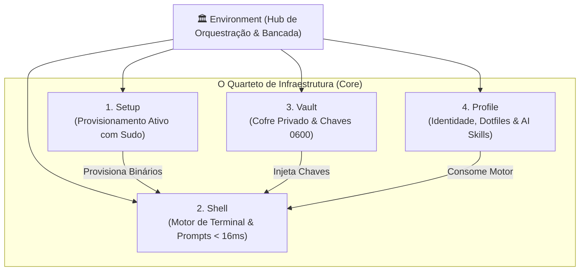

# 🏛️ O Quarteto de Infraestrutura: Arquitetura Federada

> Documentação canônica sobre o Quarteto de Produtividade de Gabriel Frigo: os 4 repositórios soberanos que operam em sinergia sem acoplamento rígido.

---

## 🧭 Visão Geral & Filosofia Federada

O **Universal Environment** é governado pelo **Quarteto de Produtividade** (ou Quarteto de Infraestrutura): quatro repositórios independentes e complementares que cobrem integralmente o ciclo de vida de qualquer estação de trabalho ou servidor:

1. **[Setup](01-setup.md):** Provisionamento ativo do sistema operacional com privilégios de superusuário (`sudo`/`doas`), pacotes de software, serviços e configurações de baixo nível de hardware.
2. **[Shell](02-shell.md):** Motor interativo de terminal, prompts ultra-rápidos (< 16ms), multiplexação de interpretadores e biblioteca semântica `_ui_*`.
3. **[Vault](03-vault.md):** Cofre criptográfico privado de segredos, chaves SSH, arquivos `.env` e permissões de segurança estritas (0700/0600).
4. **[Profile](04-profile.md):** Identidade declarativa do usuário, links simbólicos seguros no `$HOME`, dotfiles de editores/terminais e catálogo de skills cognitivas de IA.



---

## 📐 Contratos de Responsabilidade & Desacoplamento

Cada repositório obedece a um contrato funcional estrito (Princípios 1 a 4 de `PRINCIPLES.md`):

| Repositório |      Privilégios      | Escopo de Arquivos                                 | Visibilidade | Invariante Central                                     |
| :---------- | :-------------------: | :------------------------------------------------- | :----------: | :----------------------------------------------------- |
| **Setup**   | Superusuário (`root`) | `/etc`, `/usr`, `/var`, `/opt`                     |   Público    | Idempotência e elevação antifrágil imune a `set -e`.   |
| **Shell**   |     Usuário Comum     | `/usr/local/share/shell` ou `~/.local/share/shell` |   Público    | Latência de prompt imperceptível (< 16ms) em 4 shells. |
| **Vault**   |     Usuário Comum     | `~/.local/share/vault`                             | **Privado**  | Zero vazamento público e auto-cura de permissões 0600. |
| **Profile** |     Usuário Comum     | `$HOME` (`~/.config`, `~/.local`)                  |   Público    | Governança XDG, links seguros e hermetismo de IA.      |

---

## 📚 Índice da Seção

| Arquivo                              | Título                                      | Foco Operacional                                                                                  |
| :----------------------------------- | :------------------------------------------ | :------------------------------------------------------------------------------------------------ |
| **[`01-setup.md`](01-setup.md)**     | Setup: Provisionamento Ativo                | Receitas atômicas, modelo zero-clone via GitHub RAW, matriz multi-SO e elevação imune a `set -e`. |
| **[`02-shell.md`](02-shell.md)**     | Shell: Motor Interativo de Terminal         | Multiplexação de shells, prompts com latência < 16ms, biblioteca `_ui_*` e contextos de SO.       |
| **[`03-vault.md`](03-vault.md)**     | Vault: O Cofre Criptográfico                | Isolamento de chaves SSH, loaders multi-shell seguros e endurecimento de permissões 0600.         |
| **[`04-profile.md`](04-profile.md)** | Profile: Identidade & Dotfiles Declarativos | Gestão de dotfiles no `$HOME`, links simbólicos defensivos, XDG e AI skills portáteis.            |

---

## ⚡ Comandos de Orquestração

A partir da raiz do Environment, o Makefile orquestra operações simultâneas sobre o Quarteto:

```sh
# Auditar status de versão de todos os componentes
make status

# Executar suíte completa de testes de qualidade
make test

# Executar todas as auditorias estáticas de código
make audit
```
