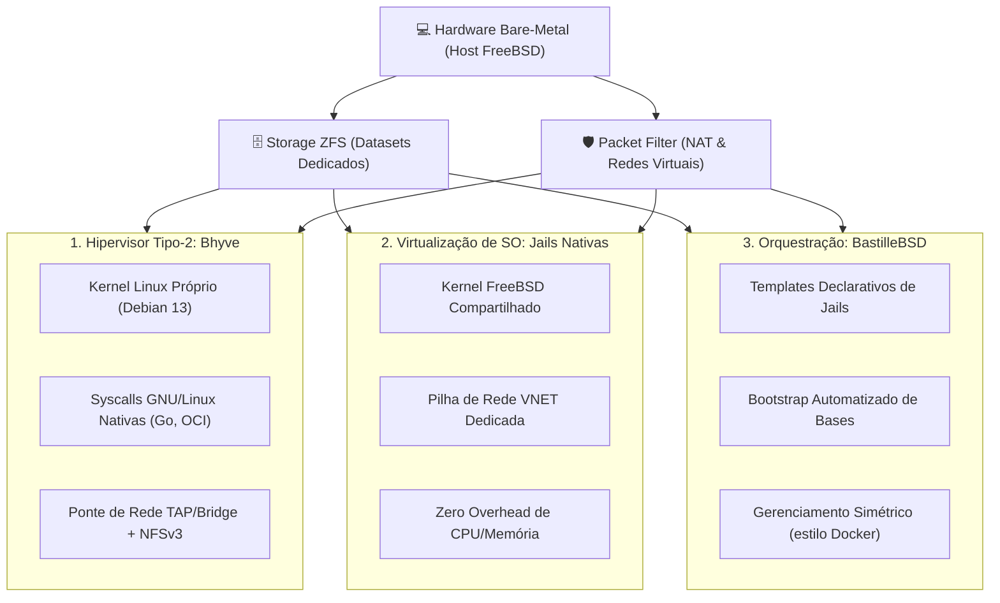

# 📦 Virtualização & Isolamento no FreeBSD: A Tríade Soberana

> Arquitetura comparativa, casos de uso e governança das três camadas de isolamento e execução no FreeBSD: Hipervisor Tipo-2 (Bhyve), Containers no nível do SO (Jails) e Orquestração Declarativa (BastilleBSD).

---

## 🧭 Visão Geral & Filosofia de Isolamento

O FreeBSD disponibiliza três primitivas nativas de isolamento, cada uma projetada para um nível diferente de abstração, sobrecarga e controle de kernel:



---

## 📊 Matriz Comparativa das Tecnologias

| Dimensão                  | 🖥️ Bhyve (VM Headless)              | 🛡️ Jails Nativas                      | 🏰 BastilleBSD                     |
| :------------------------ | :---------------------------------- | :------------------------------------ | :--------------------------------- |
| **Tipo de Isolamento**    | Hipervisor de Hardware (Tipo-2)     | Namespaces de Processos & FS          | Orquestrador de Jails              |
| **Kernel Utilizado**      | Kernel convidado (Linux 6.12/GNU)   | Kernel do Host (FreeBSD 15)           | Kernel do Host (FreeBSD 15)        |
| **Overhead de RAM/CPU**   | 2 GB fixos + virtualização VT-x     | Virtualmente zero (processos nativos) | Virtualmente zero                  |
| **Pilha de Rede**         | Interface `tap0` em ponte `bridge0` | VNET (`epair`) ou IP compartilhado    | VNET automatizada com NAT          |
| **Storage Subjacente**    | Dataset ZFS com arquivo RAW/ZVOL    | Dataset ZFS (`zroot/jails/...`)       | Dataset ZFS (`zroot/bastille/...`) |
| **Principal Caso de Uso** | Google Antigravity CLI, Docker/OCI  | Serviços FreeBSD de produção          | Ambientes efêmeros e testes        |

---

## 📚 Índice da Seção

| Subsistema           | Caminho                           | Foco Arquitetural e Operacional                                                       |
| :------------------- | :-------------------------------- | :------------------------------------------------------------------------------------ |
| **Hipervisor Bhyve** | [`bhyve/`](bhyve/README.md)       | Execução de VM Debian 13 para ferramentas dependentes de syscalls Linux (`agy`, OCI). |
| **Jails Nativas**    | [`jails/`](jails/README.md)       | Isolamento leve de serviços nativos do FreeBSD com pilha de rede virtualizada VNET.   |
| **BastilleBSD**      | [`bastille/`](bastille/README.md) | Orquestração declarativa de containers FreeBSD baseada em templates e ZFS.            |

---

## ⚡ Comandos Rápidos & Referência Diária

### Hipervisor Bhyve:

```sh
# Verificar status da VM Debian
vm list
# Iniciar VM em modo headless
vm start debian
# Conectar ao console serial nmdm
vm console debian
```

### Jails Nativas:

```sh
# Listar jails ativas no host
jls -v
# Iniciar jail específica
sudo jail -c -f /etc/jail.conf minha_jail
# Executar comando interativo dentro da jail
sudo jexec minha_jail /bin/sh
```

### BastilleBSD:

```sh
# Listar containers Bastille
sudo bastille list
# Iniciar container
sudo bastille start container01
# Executar comando remoto dentro do container
sudo bastille cmd container01 pkg update
```
