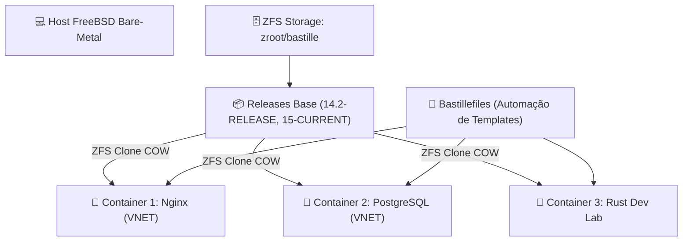

# 🏰 BastilleBSD: Orquestração Declarativa de Containers FreeBSD

> Documentação canônica do BastilleBSD: o orquestrador moderno e declarativo de Jails e templates ZFS no FreeBSD.

---

## 🧭 Visão Geral & Filosofia do BastilleBSD

O **BastilleBSD** é uma ferramenta de automação e orquestração de Jails de código aberto, projetada para combinar a **segurança militar e eficiência extrema das Jails do FreeBSD** com a **ergonomia e simplicidade declarativa do ecossistema moderno de containers** (semelhante ao Docker/Podman, porém sem demônios pesados ou camadas desnecessárias de virtualização).

No Universal Environment, o Bastille opera como a ferramenta ideal para:

1. **Provisionamento Repetível:** Criação de instâncias isoladas em segundos a partir de _releases_ base do FreeBSD compartilhadas via ZFS clone (copy-on-write).
2. **Templates Declarativos (Bastillefiles):** Arquivos declarativos autocontidos que definem pacotes, arquivos de configuração, serviços e comandos a serem aplicados no container.
3. **Consumo Quase Zero de Recursos:** Ao contrário do Docker no Linux que gera dezenas de bridges, sobreposições de overlayfs complexas e alto consumo de memória, o Bastille alavanca datasets ZFS nativos e processos FreeBSD diretos.



---

## 📚 Índice da Seção

| Arquivo                                                                | Título                             | Foco Operacional                                                                                 |
| :--------------------------------------------------------------------- | :--------------------------------- | :----------------------------------------------------------------------------------------------- |
| **[`01-bootstrap-e-templates.md`](01-bootstrap-e-templates.md)**       | Bootstrap & Automação de Templates | Instalação, bootstrap de releases oficiais, estrutura de diretórios e sintaxe dos Bastillefiles. |
| **[`02-ciclo-de-vida-e-operacao.md`](02-ciclo-de-vida-e-operacao.md)** | Ciclo de Vida, Rede & Operação     | Comandos de gestão (`create`, `start`, `stop`, `cmd`, `rdr`), redes VNET e snapshots ZFS.        |

---

## ⚡ Comandos Rápidos & Sanity Check

```sh
# Listar todos os containers e releases gerenciados pelo Bastille
sudo bastille list

# Exibir uso de storage e datasets ZFS dos containers
sudo bastille zfs list

# Iniciar um container específico
sudo bastille start container01

# Executar comando interativo no container
sudo bastille cmd container01 uptime

# Acessar console interativo do container
sudo bastille console container01
```
