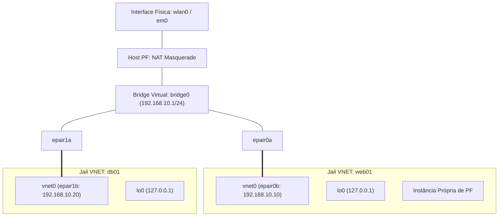

# 🌐 Configuração Declarativa do `/etc/jail.conf` & Redes VNET

> Guia canônico para provisionamento declarativo de Jails no FreeBSD com isolamento de pilha de rede virtualizada via VNET e interfaces virtuais `epair(4)`.

---

## 🧭 Shared IP vs. VNET: A Evolução da Rede em Jails

Historicamente, as Jails do FreeBSD operavam no modelo **Shared IP (IP Compartilhado)**: a Jail utilizava um alias de endereço IP associado a uma interface física do host. Embora simples, esse modelo impunha sérias limitações:

- A Jail não podia configurar seu próprio firewall (`pf` ou `ipfw`).
- Não havia suporte para múltiplos serviços escutando na mesma porta em interfaces de loopback separadas.
- Aplicações que necessitam de manipulação de sockets crus (`raw sockets`) ou roteamento dinâmico eram restritas.

Com a introdução do **VNET (Virtual Network Stack)**, cada Jail recebe sua própria instância isolada de toda a pilha de rede do kernel:

1. Tabela de roteamento independente (`netstat -rn`).
2. Interface de loopback dedicada (`lo0` em `127.0.0.1`).
3. Instância própria de firewall Packet Filter (`pf`).
4. Interfaces virtuais conectadas por portas de pontes comutadas em software (`bridge(4)`).



---

## 🗄️ Configuração Declarativa: `/etc/jail.conf`

O utilitário `jail(8)` lê nativamente suas especificações a partir do arquivo `/etc/jail.conf`. O arquivo adota herança hierárquica, onde blocos globais definem parâmetros padrão aplicados a todas as instâncias:

```text
# ================================================================
# Parâmetros Globais Aplicados a Todas as Jails
# ================================================================
exec.start = "/bin/sh /etc/rc";
exec.stop  = "/bin/sh /etc/rc.shutdown";
exec.clean;
mount.devfs;
devfs_ruleset = 4;

# Parâmetros de VNET
vnet;
vnet.interface = "vnet0";

# ================================================================
# Jail: web01 (Exemplo com VNET e Bridge)
# ================================================================
web01 {
    host.hostname = "web01.lab.local";
    path = "/usr/jails/web01";

    # Criação dinâmica do par epair antes do boot da jail
    exec.prestart  = "ifconfig epair0 create up";
    exec.prestart += "ifconfig bridge0 addm epair0a up";
    vnet.interface = "epair0b";

    # Destruição do par epair após o encerramento da jail
    exec.poststop  = "ifconfig epair0a destroy";

    # Configuração de rede injetada no início do boot da jail
    exec.start += "ifconfig epair0b name vnet0";
    exec.start += "ifconfig vnet0 inet 192.168.10.10/24 up";
    exec.start += "route add default 192.168.10.1";
}
```

---

## 🛡️ Integração com o Packet Filter (PF) no Host

Para que as Jails VNET acessem a internet através da interface primária do host (por exemplo, `wlan0`), o arquivo `/etc/pf.conf` do host deve realizar NAT da sub-rede das Jails (`192.168.10.0/24`):

```text
ext_if = "wlan0"
jail_net = "192.168.10.0/24"

# NAT para saída das Jails
nat on $ext_if from $jail_net to any -> ($ext_if)

# Liberação de encaminhamento
pass in on bridge0 proto { tcp, udp, icmp } from $jail_net to any
pass out on $ext_if proto { tcp, udp, icmp } from ($ext_if) to any
```

Para aplicar no host:

```sh
# Ativar o roteamento de pacotes IPv4 no kernel
sudo sysctl net.inet.ip.forwarding=1

# Recarregar as regras do PF
sudo pfctl -f /etc/pf.conf
```

---

## 🚀 Ciclo de Vida & Operação

```sh
# Criar diretório base do dataset ZFS para a jail
sudo zfs create -o mountpoint=/usr/jails/web01 zroot/jails/web01

# Extrair base do sistema na raiz da jail
sudo fetch -o /tmp/base.txz https://download.freebsd.org/releases/amd64/15.0-CURRENT/base.txz
sudo tar -xf /tmp/base.txz -C /usr/jails/web01

# Inicializar resolv.conf para resolução de nomes
echo "nameserver 1.1.1.1" | sudo tee /usr/jails/web01/etc/resolv.conf

# Iniciar a jail em segundo plano
sudo jail -c web01

# Acessar a jail interativamente
sudo jexec web01 /bin/sh
```
