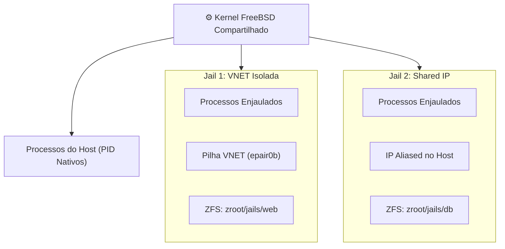

# 🛡️ Jails FreeBSD: Isolamento Leve de Sistema

> Documentação canônica sobre Jails nativas no FreeBSD: isolamento a nível de kernel, particionamento de processos, namespaces e governança de recursos.

---

## 🧭 Visão Geral & Filosofia das Jails

As **Jails** representam o mecanismo histórico e fundamental de virtualização a nível de sistema operacional do FreeBSD, introduzidas pioneiramente no FreeBSD 4.0 (ano 2000) por Poul-Henning Kamp — anos antes do advento de tecnologias equivalentes como Solaris Zones ou Linux Containers (LXC/Docker).

Diferente de máquinas virtuais completas (como o Bhyve), que emulam placas de rede, barramentos PCI e processadores para executar um kernel convidado independente:

1. **Kernel Único:** Uma Jail compartilha o mesmo kernel do host FreeBSD, eliminando virtualmente qualquer sobrecarga (overhead) de CPU ou consumo reservado de memória RAM.
2. **Quatro Pilares de Isolamento:**
    - **Namespace de Arquivos:** Cada Jail opera em uma raiz de diretórios isolada via `chroot(2)` blindado contra escape (`jail_attach(2)`).
    - **Namespace de Processos:** Processos dentro da Jail enxergam exclusivamente outros processos pertencentes à mesma Jail.
    - **Namespace de Rede (VNET):** Com VNET (_Virtual Network Stacks_), cada Jail possui sua própria tabela de roteamento, interfaces `epair(4)` dedicadas, firewall PF e regras de loopback independentes.
    - **Restrição de Privilégios (root na Jail $\ne$ root no Host):** Mesmo como superusuário (`root`), processos enjaulados são incapazes de carregar módulos de kernel (`kldload`), manipular interfaces físicas ou acessar memória do sistema (`/dev/mem`).



---

## 📚 Índice da Seção

| Arquivo                                                              | Título                          | Foco Operacional                                                                                                 |
| :------------------------------------------------------------------- | :------------------------------ | :--------------------------------------------------------------------------------------------------------------- |
| **[`01-jail-conf-e-redes-vnet.md`](01-jail-conf-e-redes-vnet.md)**   | Configuração Declarativa & VNET | Sintaxe moderna do `/etc/jail.conf`, interfaces `epair(4)`, pontes de rede e endereçamento IP isolado.           |
| **[`02-seguranca-e-devfs-rules.md`](02-seguranca-e-devfs-rules.md)** | Devfs Rulesets & Segurança      | Proteção de dispositivos de hardware, regras `/etc/devfs.rules`, parâmetros `allow.raw_sockets` e `securelevel`. |

---

## ⚡ Comandos Rápidos & Sanity Check

```sh
# Listar todas as jails ativas com detalhes de VNET e paths
jls -v

# Exibir parâmetros configurados de uma jail específica
jls -j minha_jail -n

# Conectar uma sessão de shell interativa dentro da jail
sudo jexec minha_jail /bin/sh

# Iniciar ou reiniciar uma jail declarada no /etc/jail.conf
sudo jail -c minha_jail
sudo jail -r minha_jail

# Destruir e parar uma jail forçadamente
sudo jail -r -f minha_jail
```
