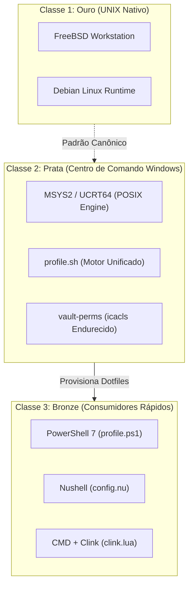

# 🪟 Suporte & Interoperabilidade Windows

> Documentação canônica sobre o ecossistema Windows no Universal Environment: a Arquitetura Tripartite, emuladores de terminal modernos e interoperabilidade segura com o UNIX.

---

## 🧭 Visão Geral & Filosofia da Arquitetura Tripartite

Integrar o ecossistema UNIX a estações de trabalho Microsoft Windows sem abrir mão da segurança criptográfica, desempenho de terminal e elegância de código exige uma arquitetura rigorosamente estratificada.

No Universal Environment, o suporte ao Windows é governado pela **Hierarquia Tripartite de Três Classes**:

1. **Classe 1 (Ouro) — UNIX Nativo:** FreeBSD e Linux bare-metal. É o padrão de referência absoluto (_ground truth_) de engenharia, onde todo o tooling POSIX opera sem camadas de tradução.
2. **Classe 2 (Prata) — MSYS2 (Centro de Comando Soberano no Windows):** Ambiente POSIX de alta fidelidade rodando nativamente no Windows. Provê `/bin/sh`, utilitários GNU, `git` e suporte a symlinks NTFS nativos (`MSYS=winsymlinks:nativestrict`). É o responsável por executar scripts de sincronização de dotfiles (`profile.sh`) e governança de repositórios.
3. **Classe 3 (Bronze) — Terminais Nativos Rápidos:** Consumidores leves e rápidos do dia a dia: **PowerShell 7 (`pwsh`)**, **Nushell (`nu`)** e **CMD com Clink**. Eles não tentam duplicar lógica de infraestrutura complexa; em vez disso, carregam dotfiles simplificados com UI semântica `_ui_*` e delegam operações pesadas à Classe 2.



---

## 📚 Índice da Seção

| Arquivo                                                              | Título                                 | Foco Operacional                                                                                     |
| :------------------------------------------------------------------- | :------------------------------------- | :--------------------------------------------------------------------------------------------------- |
| **[`01-powershell-e-nushell.md`](01-powershell-e-nushell.md)**       | Perfis de Terminal & Emissão Semântica | Dotfiles para PowerShell 7 e Nushell, biblioteca `_ui_*` em PowerShell e atalhos simétricos (`up*`). |
| **[`02-seguranca-e-ssh-pageant.md`](02-seguranca-e-ssh-pageant.md)** | Chaves SSH, Pageant & Permissões       | Gestão de chaves PuTTY `.ppk`, integração Pageant/OpenSSH e endurecimento de ACLs via `icacls`.      |

---

## ⚡ Comandos Rápidos & Sanity Check

```powershell
# (PowerShell 7) Inspecionar versão do PowerShell
$PSVersionTable.PSVersion

# (PowerShell 7) Testar biblioteca semântica _ui_*
_ui_banner "WINDOWS TERMINAL"
_ui_step "Validando ambiente de terminal"
_ui_ok "PowerShell 7 pronto e operacional"

# (PowerShell 7) Auditar integridade de dotfiles e status Git
sync-profile -Status
```
